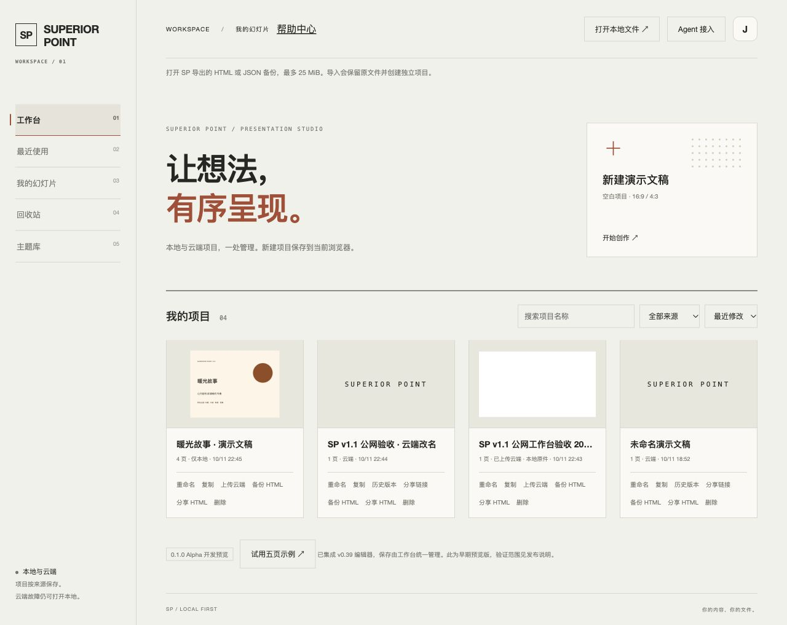
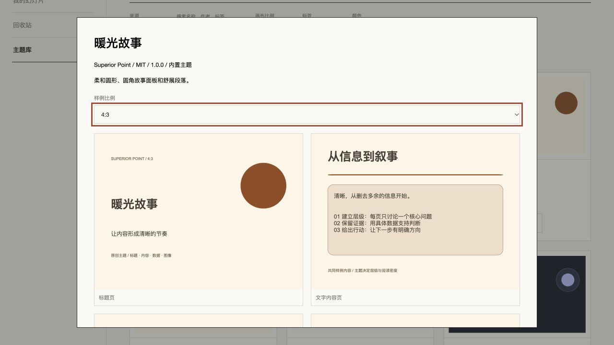
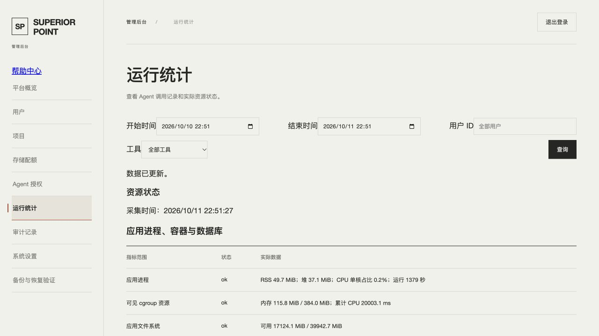

# v1.1 非编辑器服务批次 · Hakari 验收

2026-10-11，本批次已部署且验收通过。应用仍为 **0.1.0-alpha**；这不代表 v1.1 全部 54 项或 Stable 交付。编辑器会话本轮未布置任务，其后续工作区改动未进入发布。

## 发布身份与现有数据

- 生产：<https://sp.jxcz.top>；Hakari / cn-guangzhou / Linux amd64。
- 已部署源码：`93ebf03641a673e726682c5c77e125833c1e5250`，目录 `/opt/superior-point/releases/93ebf03`。
- 镜像：`superior-point-app:93ebf03`，镜像 ID `sha256:aed15efaac7cabcbe521f5a3da974841ed7ecbc814ccc01966cfb2559a6cd627`；revision label 与源码一致。Linux 原生构建退出 0。
- 源码归档 SHA256：`b3b91b757ff1a41081c253ac01c9f319e199c18c6a9c9b0afadc9406223947d1`，上传前后匹配。
- 迁移 006–009 提交成功，旧迁移校验和匹配。切换前后 **7 个已有项目**的 ID、修订、内容指纹匹配。指纹核对不是数据库备份。
- 只切换 SP 应用。最终应用 healthy、OOM=false、重启次数 0。nginx、postgresql@18-main、hindsight、hindsight-ui、hbrclient、mihomo 均 active，其 PID 与 NRestarts 对照部署前一致。
- 固定主机采集器及每分钟任务已部署；只读取 SP 三个指定容器的运行字段，不向应用暴露 Docker socket。最终主机采集距读回 28 秒，管理页确认后续分钟刷新。app/db healthy；caddy running（未配置 healthcheck），三者无 OOM、无重启。

## 分层验证

[源码 CI](https://github.com/J-X-C-Z/Superior-Point/actions/runs/38146941370) 对上述发布 SHA 为 success：82/82 服务测试、271/272 常规测试通过，1 项原有有意跳过、0 失败；类型检查与构建通过。运行统计中的两个 FORBIDDEN 是授权边界验收的预期拒绝。

公网验收脚本退出 0，[原始结果](../verification/v11/services-public-results.json) 的七阶段均成功：

1. 隔离测试账号与两份测试项目。
2. 6 个内置主题、历史读取/差异、恢复幂等。
3. 固定修订分享，后续修改不改变分享快照；撤销后 404。
4. 官方 SDK 实际访问原生 HTTP MCP 和 stdio Bridge，均列出 20 个工具；使用相同生产 PostgreSQL 读写。
5. OAuth S256 PKCE、单项目只读范围；越界读取和写入拒绝、REST 拒绝 OAuth、撤销后拒绝。
6. 管理全局搜索、存储用量、工具调用元数据与真实主机资源。
7. SSE 修订元数据通知、会话撤销关闭流。

脚本仅操作自建测试内容；PAT/OAuth/分享均撤销，测试账号禁用，测试管理会话退出，清理失败 0。保留测试审计记录，不删除真实用户。

另用真实公网浏览器验证：本地/云端同一列表、本地上传云端及读回、云端双击改名不改变本地原件、6 套主题列表、4:3 样例、从主题新建 4 页稿、管理页真实主机/容器状态。三份浏览器自建测试稿已移入可恢复回收站；恢复原先云端新建位置，原有用户项目未改动。

本地真实浏览器还验证分享播放/撤销、SSE 仅提示新修订而不覆盖草稿、账号会话/用量界面，以及 320/390/768px 视口布局。[本地证据](v11-services-local.md) 与公网脚本证据分别记录，视口模拟不等于真机触控验收。

## 本轮边界与延期

- 按用户决定 **保留新版，暂不进行实际回滚演练**；旧 release/image 保留，回退脚本已准备，未将准备工作写为演练通过。已完成正常迁移与应用切换。
- 生产备份、离机备份、整机启动恢复、外部告警闭环继续延期；本轮未执行生产备份或整机重启，因此无备份恢复保障证明。
- 编辑器、PPTX/素材/大型 PPT 路线项、真实移动触控与本批次 Firefox/PPTX 视觉验收未完成。
- MCP 资源工具依赖素材库；stdio 全工具耗时统计未完成；项目协作 ACL 本轮仅完成评估；列表使用轻量元数据与每页 24 张卡片，不宣称服务器项目分页或完整大库压力验收。
- 第三方终端用户 Codex/Claude 账号连接、真实浏览器 OAuth 同意操作未验收；SDK 的生产 PKCE 协议测试已通过。

[草稿 PR #4](https://github.com/J-X-C-Z/Superior-Point/pull/4) 以 foundation 分支为基线，未合并 main。本文及登记更新属于发布后文档，不改变上述已部署源码 SHA。
