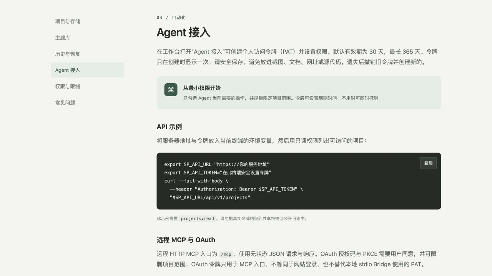

# v1.2 PowerPoint 验收与帮助增补 · Hakari 发布

2026-10-12（Asia/Shanghai）。本批请求已完成：PowerPoint 限定样例验收、具体 PPTX 限制诊断和帮助文案修正，通过验证后部署到 https://sp.jxcz.top 。编辑器候选补丁未纳入此次发布，编辑器会话未分配任务。

## 精确发布身份

| 项目 | 验证结果 |
|---|---|
| 源码 | `c90c4ff74b7407e5af2cd29abe80120eacf5fb50`，`roadmap/v1.2-theme-resources` |
| 草稿 PR | https://github.com/J-X-C-Z/Superior-Point/pull/6 ，未合并 main |
| 精确源码 CI | https://github.com/J-X-C-Z/Superior-Point/actions/runs/38195160356 ，completed/success，headSha 匹配 |
| 目标 | Hakari `i-7xv7se8pshu9lm5q5j5n`，cn-guangzhou，Linux x86_64 |
| 归档 SHA-256 | `001edab94f48c911e5beebc63e5807e439b274ec44a62ba47625379667e01e2d`，本机/上传后相同 |
| 镜像 | `superior-point-app:c90c4ff`，Linux amd64 |
| 镜像 ID | `sha256:fb0570d1c848247bde90f695f3945035d1ede1dadde9b7dfd19c57a0834d1d7a` |
| OCI revision | 匹配完整源码 SHA |
| 当前目录 | `/opt/superior-point/releases/c90c4ff` |
| 保留旧发布 | `/opt/superior-point/releases/0887d41` 及旧镜像；未演练回滚 |

工作区 `/private/tmp/sp-v11-services` 本机执行：`npm test` 291 项、290 通过、1 项已有跳过、0 失败；主题服务/MCP 聚焦 6/6、类型检查和构建退出码均为 0。精确源码 CI 另执行完整服务与常规测试、类型检查和构建，全部通过。原始日志 `/private/tmp/sp-v12-pp-js.log`、`sp-v12-pp-service-focused.log`、`sp-v12-pp-typecheck.log`、`sp-v12-pp-build.log`、`sp-v12-pp-ci.log`。

## PowerPoint 与帮助结果

Microsoft PowerPoint 16.113.4 / build 16.113.26100421 实际打开六份正式 UI 导出的五页 PPTX，共 30 页，包括三种精选主题和同稿 Skin 对照；文字、图形、图片可见，没有文件修复错误。对象可选择，放映逐页前进；图表样式有差异，动画/转场不导出。原图是 160×100 的栅格样例，放大像素边缘不构成导出分辨率下降的测量证据。详见[本机实测报告](v12-powerpoint-local.md)。

`PPTX_LIMITATIONS` 保持原代码、状态与接口形状，新增具体说明：字体不嵌入、图表字体 Arial；图像效果栅格化；组合展平；图表/表格可能有差异；备注及隐藏页保留；动画/转场缺失。静态诊断不宣称 PowerPoint 视觉保真。帮助中心同步 22 个工具、主题工具权限、已部署的 SSE 元数据通知与 PPTX 分享边界。

上线帮助页面在真实浏览器中显示以上修正。

## Linux 发布与公网验收

只上传 `git archive` 源码，未上传 macOS 依赖。Hakari Docker 原生 Linux 构建退出码 0；镜像内 Node ELF x86-64 与 esbuild 运行探针通过。已应用迁移 checksum 全部匹配，迁移命令成功；没有新增或改写旧迁移。发布脚本仅重建 SP app。

切换退出码 0，18 个切换前项目全部保留，修订未回退，同修订内容指纹一致。该指纹核对不是备份。SP app healthy、OOM=false、restartCount=0。nginx、postgresql@18-main、hindsight、hindsight-ui、hbrclient、mihomo 保持 active，PID 与发布前一致，NRestarts=0；数据库与其他服务未重启。

本批已提交的 `scripts/accept-v11-services.mjs` 经受保护凭据加载器执行公网验收，退出码 0。9 阶段全部通过，覆盖版本不可变/分页、二进制资源与权限、REST/MCP 诊断、指定页 Skin、22 工具、OAuth PKCE/撤销、固定分享、存储资源统计及 SSE 会话撤销；新增 `pptxLimitationsExplicit=true` 证明线上诊断具体文案已更新。

仅创建新合成账户与两份样例项目；测试 PAT、OAuth、分享全部撤销，合成账户禁用，管理员会话退出，cleanup failures 为空。未修改真实用户项目，未永久删除数据。

原始脱敏证据：[公网验收](../verification/v12-powerpoint/protocol-public.json)、[切换](../verification/v12-powerpoint/cutover.log)、[运行状态](../verification/v12-powerpoint/final-status.log)、[镜像探针](../verification/v12-powerpoint/image-probe.log)、[CI](../verification/v12-powerpoint/ci.json)。

## 保留边界

Firefox、离线 HTML 验收、生产备份与回滚演练按用户决定继续延期，没有执行。PowerPoint 结果仅覆盖所列六份文件及本机版本，不保证所有字体、复杂对象或全量 PPTX 保真。真实规模浏览器性能、窄屏覆盖和完整编辑器 Motion Runtime 仍未验收，不将本批声明为全量 Beta/Stable。
