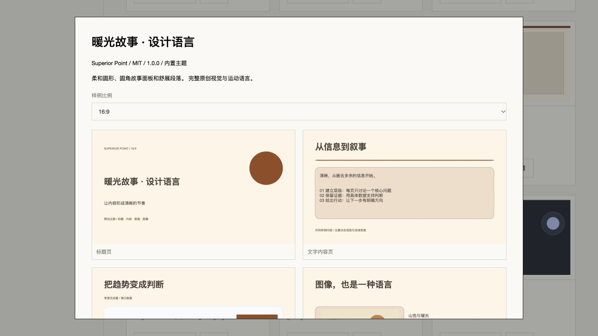

# 主题库 v1.2 · 本轮 Hakari 发布验收

2026-10-12，本轮设计语言/选页 Skin 增量已部署并验收通过。应用仍为0.1.0-alpha；不是整个v1.2、Beta或Stable验收完成声明。[本地实现与证据](v12-theme-library-local.md)，[32项进度与剩余工作](../architecture/theme-library-v1.2-progress.md)。编辑器会话未布置任务。

## 发布身份与数据

- 站点：<https://sp.jxcz.top/app>；Hakari cn-guangzhou，Linux x86_64 / amd64。
- 已部署源码：`9841d84b0d0dcc023d4bebb2a75aa987fbb84cf5`；目录 `/opt/superior-point/releases/9841d84`，镜像 `superior-point-app:9841d84`。
- 镜像ID：`sha256:a3d3857be616b0c6d1624407fefa8b4e37b6e5024516ff506b3ae7f0dbf3d7bd`；revision label与源码一致。
- 源码归档SHA256：`1ea1a6e649b60f02a6c709a5c0fb0727516688b63c60fa1b2c1bbcd0e1f1f88a`，上传前后校验通过。
- [精确源码 CI](https://github.com/J-X-C-Z/Superior-Point/actions/runs/38187018077) success；本地同一源码83/83服务、280常规测试通过（1原有跳过、0失败），类型检查和构建通过。
- Linux原生构建首轮在esbuild安装遇到ETXTBSY；保留原日志，同一源码重试退出0。未上传macOS node_modules。
- 无新迁移；已应用迁移校验和匹配，迁移命令提交成功。切换前后**10个现有项目**的ID/修订/内容指纹核对通过。该指纹不是备份。
- 发布命令30秒通信超时，应用已启动且指纹文件已完成；读回确认脚本已结束，单独核对数据/镜像/健康后补齐`.env`版本标记与current路径，没有重复重启应用。
- 最终应用healthy，OOM=false，重启0。nginx、postgresql@18-main、hindsight、hindsight-ui、hbrclient、mihomo均active，PID及重启次数与本轮发布前一致。监控数据继续刷新；旧93ebf03发布/镜像保留。

## 公网协议与界面

[原始8阶段结果](../verification/v12/theme-public-results.json) `ok:true`，运行 `spv12_accept_mv4iaj1z_0d5463`，退出0。

验证主题/历史恢复、固定快照分享与撤销、官方SDK HTTP/stdio 22工具、三套完整设计语言和每套五页4:3样例、选页只读计划不写入、未选页等价、逐页版本快照、同请求幂等重试、过期预览409、OAuth PKCE/单项目只读/撤销、用量/监控、SSE通知与会话撤销。

此前两次合成验收的失败来自测试脚本：把JSON字段顺序作为相等条件，以及对只读预览错误传入写入幂等字段。服务分别保留幂等数据、严格拒绝非法请求；脚本改为结构相等和合法预览请求后，全部8阶段通过，生产源码未改动。原失败日志保留于本机`/private/tmp/sp-v12-public-attempt1.json`与`attempt2.json`。

每次仅操作自建测试账号和项目；测试PAT/OAuth/分享撤销，合成账号禁用，管理测试会话退出，清理失败0。未删除真实用户或永久清空项目。

实际公网浏览器确认新版9项目录、三套新增设计语言入口、完整来源/许可/运动说明与五页样例。实际编辑器新建/单页应用/撤销/保存重开证据在本地记录中；公网SDK验收不冒充真实浏览器操作。

## 留待后续

完整Motion Runtime、减少动态强制播放、Firefox/触控设备/离线导出文件/PPTX视觉、大库性能、多设备主题同步、签名/升级界面/资产独立存储仍待完成或验收。上游许可未确认，未复制上游素材；适配器是人工声明式映射。AI重构及社区市场属于后续P2。

备份、离机备份、整机恢复及实际回滚演练继续按用户决定延期。旧发布保留不等于回滚演练已通过，因此不能声明Stable恢复保障。

[草稿PR #5](https://github.com/J-X-C-Z/Superior-Point/pull/5) 堆叠于服务分支，未合并main。发布后的验收脚本/报告提交不会改变上述已部署源码SHA。
