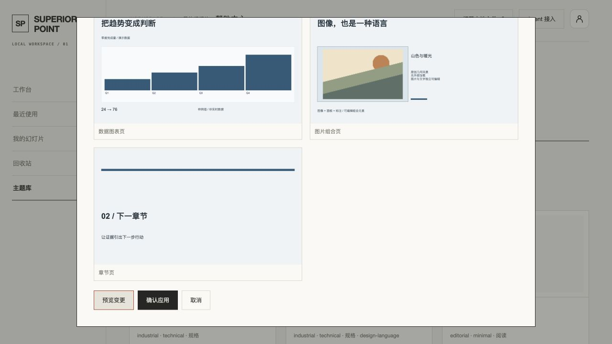
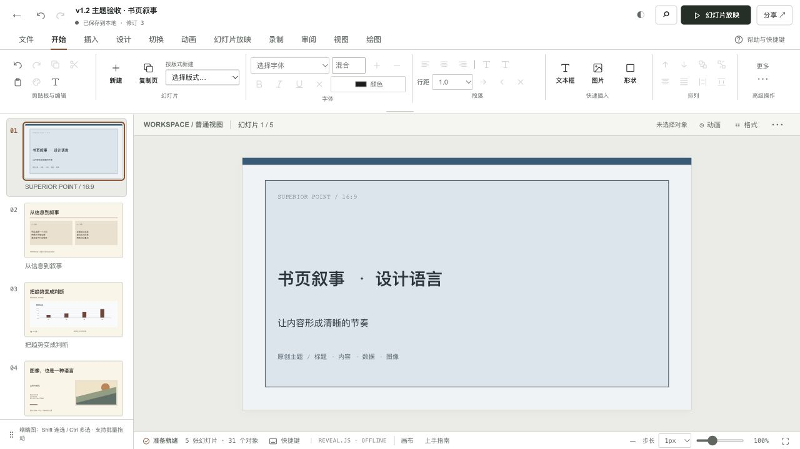
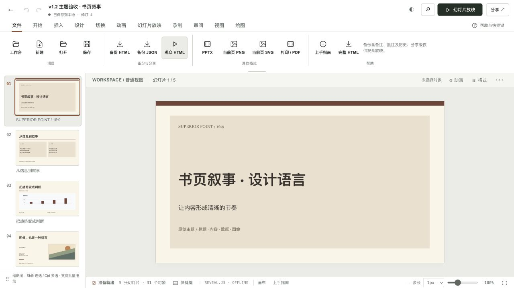

# 主题库 v1.2 · 本轮本地交付

2026-10-12，分支 `roadmap/v1.2-theme-library`，基线 `ef869b3`。本轮开发了路线图的契约、三语言资源、局部 Skin 和服务/MCP 增量；不是全部 SP-T001–T032 完成声明，也不是 Beta/Stable 声明。未布置编辑器会话任务、未更改上游仓库、未运行生产备份或实际回滚演练。

## 实现

复用 ThemeStore、ThemeService、Document Core 和 ProjectService。Theme Manifest v1 在旧格式上增加受限 `designLanguage`：身份/适用/禁忌/来源/许可、视觉规则、运动词汇/时长/降级规则，旧文稿和安全未知扩展仍可读取。新格式不执行外部脚本、任意 CSS 或资源 URL。

保留六套旧主题的 ID、版本与哈希；增加三套独立原创设计语言样例：书页叙事、标尺精度、暖光故事。每套有封面/正文/数据/图文/章节五页，真实 Core 对象可编辑。它们继承已有原创主题的规则，具有独立新 ID，明确属于原创派生条目，不冒充上游设计语言。

Skin 计划可按整篇、单页或选中页运行，显示实际样式差异、保留的手工覆盖与多渲染器动效诊断；修改选择使预览失效。提交核对预览修订，通过现有租约/CAS/配额/幂等事务写入。逐页固定快照支持混合主题，未选页和原始内容/坐标/备注/图片/对象 ID/动画保持原样，撤销恢复。

新增只读项目主题预览与兼容接口，MCP 增加 `sp_preview_theme_application`、`sp_validate_theme_compatibility`，云端共22工具；主题搜索沿用列举工具。没有给旧PAT默认授予新权限。私有主题、项目/OAuth单项目授权、CSRF与重复/空选择沿用并验证既有边界，无新增数据库迁移。

上游22项清单与人工声明式适配器固定来源 `f958fd2dce57b9f7650785630bb6713d8a612604`。上游整体许可未确认，不复制上游资产；当前第十项为 midcentury-modern，不声称已证明历史未命名条目的身份。[来源记录](../themes/v1.2-upstream-inventory.md)。

## 最终源码验证

运行目录 `/private/tmp/sp-v11-services`：

| 检查 | 结果 | 原始记录 |
|---|---|---|
| `npm test` | 281项：280通过，1原有跳过，0失败，退出0 | `/private/tmp/sp-v12-js-final-state.log` |
| `TEST_DATABASE_URL=本机隔离库 SP_TEST_PG_BIN=/opt/homebrew/Cellar/libpq/18.6_1/bin npm run test:service` | 83/83通过，0跳过/失败，退出0 | `/private/tmp/sp-v12-service-final-state.log` |
| `npm run typecheck:service` | 退出0 | `/private/tmp/sp-v12-typecheck-final-state.log` |
| `npm run build` | 退出0，生成单文件候选 | `/private/tmp/sp-v12-build-final-state.log` |

服务检查使用回环端口55571的隔离测试库。备份/恢复测试只针对本机隔离库，不是生产备份。中途出现的沙箱回环监听限制、旧20工具数量断言和PG工具路径错误均已修正/配置后，在上述最终整套运行通过；不以早期定向通过代替整套结果。

自动覆盖包括：新/旧主题契约、安全未知字段与哈希、无损选页/混合引用、撤销、旧主题固定哈希、样例双比例和原编辑器模型往返、MCP/HTTP只读预览不写入、私有主题隔离、范围变更幂等冲突、CAS过期、OAuth单项目范围、界面预览失效与修订绑定。

## 真实浏览器记录

本轮 Codex 内置浏览器，`http://127.0.0.1:18872/web/`，通过正式主题入口：

1. 浏览9个目录条目，查看三种设计语言详情与五页真实样例。
2. 由书页叙事新建5页文稿，打开真实v0.39编辑器；通过界面修改标题及备注并保存至修订2。
3. 选择技术主题，仅应用第1页；先显示16项实际样式变化和动效诊断，再二次确认。保存修订3，仍5页/31对象，备注保留。
4. 编辑器撤销，保存修订4；中断恢复后重新打开，标题、5页/31对象及备注均保留。此记录为保存重开，不宣称受控完整浏览器进程重启实验。
5. 通过真实编辑器文件入口执行可编辑HTML与观众HTML，界面分别显示成功与观众脱敏提示。下载事件等待曾中断，**没有取得最终导出文件的独立离线播放证据**，因此不将提示算作完整导出一致性验收。

## 保留边界

运动语言目前是受限规范、样例已有动效和兼容诊断；Skin不覆盖动画意图，不实现完整新动效Runtime，减少动态策略尚未强制作用于播放。静态SVG预览不证明字体/行距/动效忠实。Firefox、真实触控设备、离线导出文件、PPTX/PowerPoint视觉、大库性能与多设备主题同步仍待验收。签名、主题升级界面、资产独立存储、完整上游自动转换、AI重排及社区市场尚未交付；详细32项进度见[登记](../architecture/theme-library-v1.2-progress.md)。

本轮截至本报告尚未执行新版生产切换；最近已核实生产源码为93ebf03。后续部署需要记录实际源码SHA、CI与线上验收，不以本地通过代替生产结果。生产备份及实际回滚演练继续按用户决定延期。
