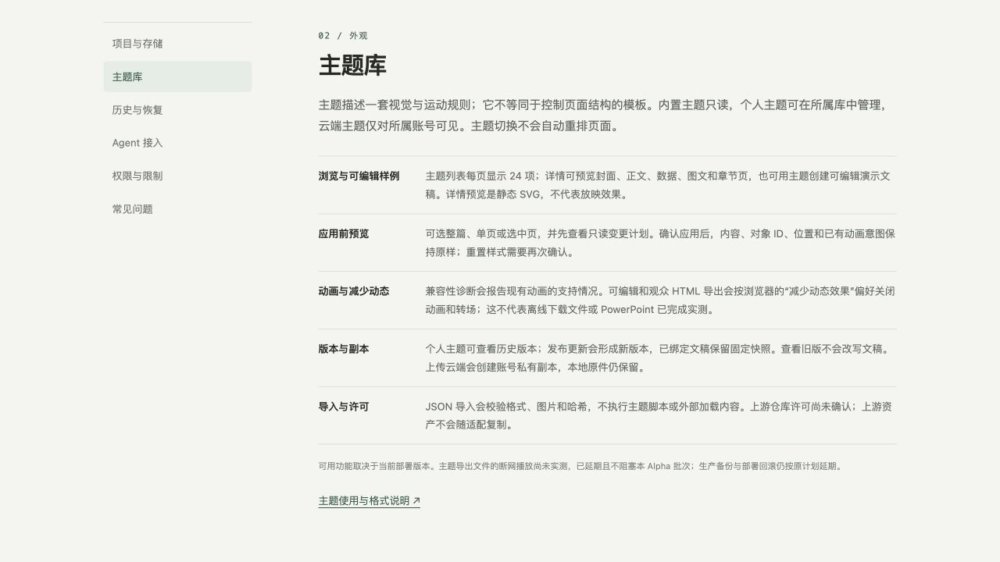

# v1.2 资源与版本增补 · Hakari 发布验收

2026-10-12。本批 Alpha 增补已部署到 https://sp.jxcz.top 。离线与 Firefox 验收、备份和回滚演练由用户明确延期；不宣称全量 Beta/Stable 验收完成。编辑器会话未分配任务。

## 精确发布身份

| 项目 | 已核对结果 |
|---|---|
| 源码 | `0887d41fec0d9bf1f92c0e230f8dabd719618bd1`，`roadmap/v1.2-theme-resources` |
| 草稿 PR | https://github.com/J-X-C-Z/Superior-Point/pull/6 ，基于主题库前批分支；未合并 main |
| 精确源码 CI | https://github.com/J-X-C-Z/Superior-Point/actions/runs/38190291684 ，completed / success，headSha 匹配 |
| 目标 | Hakari `i-7xv7se8pshu9lm5q5j5n`，cn-guangzhou，Linux x86_64 |
| 归档 SHA-256 | `1ffc2e52607f2f694868264c1c47b7a46cec9b44e7334186b1bd82210571c824`，上传后复核一致 |
| 运行镜像 | `superior-point-app:0887d41`，Linux/amd64 |
| 镜像 ID | `sha256:8154dbd1bad5f774db21a33e8bc04a59d14c1b6870c1c6962a6275810c7a706b` |
| OCI revision | 匹配上述完整源码 SHA |
| 当前目录 | `/opt/superior-point/releases/0887d41` |
| 保留旧发布 | `/opt/superior-point/releases/9841d84` 与旧镜像仍在；未进行回滚演练 |

本机只上传 `git archive` 源码，未上传 macOS 依赖或可执行文件。Hakari 执行 Docker Linux 构建，退出码 0；新镜像内 Node ELF x86-64 与 esbuild transform 探针通过。源码验证见[本机记录](v12-theme-resources-local.md)：289 项 JS 通过、1 项已有跳过；服务 84/84、类型检查、构建通过。

## 切换与公网验证

`scripts/hakari-cutover.sh` 在版本化发布目录执行。已应用迁移 checksum 匹配，没有修改旧迁移或迁移表；迁移命令成功。仅重建 SP app，16 个切换前项目仍存在，修订未回退，同修订内容指纹一致。该指纹核对不是数据库备份。

切换退出码 0，current 指向新发布，SP app healthy，OOM=false，restartCount=0。其他六个既有服务 nginx、postgresql@18-main、hindsight、hindsight-ui、hbrclient、mihomo 都保持 active，PID 与切换前一致，NRestarts=0。未执行其他服务重启。

`node .scratch/accept-public-v12.mjs` 加载受保护凭据到内存并运行已提交的 `scripts/accept-v11-services.mjs`，退出码 0，9 阶段全部通过：固定分享、HTTP/stdio 22 工具、三种设计语言五页样例、只读 Skin 预览和指定页应用、旧版本不可变/分页/MCP索引、二进制资源 MIME/hash/SRI、管理员无私有资产越权通道、匿名拒绝、REST/MCP 元数据诊断一致、OAuth PKCE/只读范围/撤销、存储资源统计、SSE 会话撤销。

公网仅操作新建合成账户和两份合成项目；测试 PAT/OAuth/分享全部撤销，合成账户禁用、管理员会话退出，cleanup failures 为空。合成账户留存数据仍计入配额，没有为了验收永久删除数据。

上线帮助页面实际浏览器已显示每页 24 项、历史版本和减少动态的新说明。

原始已脱敏记录：[公网结果](../verification/v12-resources/protocol-public.json)、[切换](../verification/v12-resources/cutover.log)、[镜像探针](../verification/v12-resources/image-probe.log)、[服务状态](../verification/v12-resources/final-status.log)、[CI](../verification/v12-resources/ci.json)。其余本机原始日志位于 `/private/tmp/sp-v12-resources-*.log`。

## 未完成与延期

本轮没有离线或 Firefox 测试。浏览器禁止 `file://`，自动审批拒绝通过本机 HTTP 打开导出件作为替代；未绕过限制，用户随后明确不做离线验收。

真实 PowerPoint 逐页视觉对照、真实浏览器千条主题性能、窄屏与跨浏览器覆盖、完整编辑器 Motion Runtime 仍没有通过证据。线上帮助中心较早的 Agent/SSE 段落仍含前批状态文字；实际工具数与 SSE 已以本报告的公网结果为准，留作后续文字修正。P2 AI/社区工作未纳入本批。
