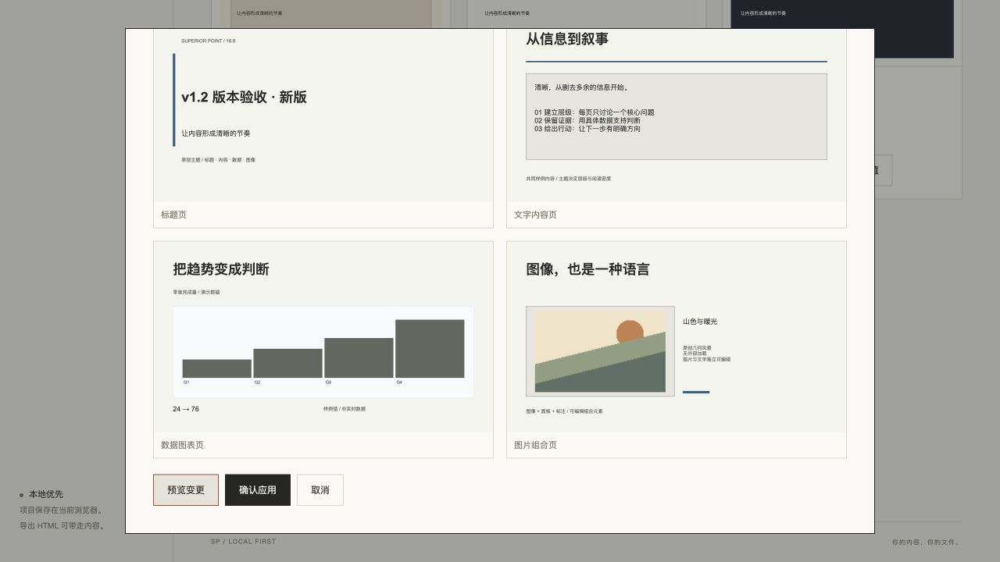
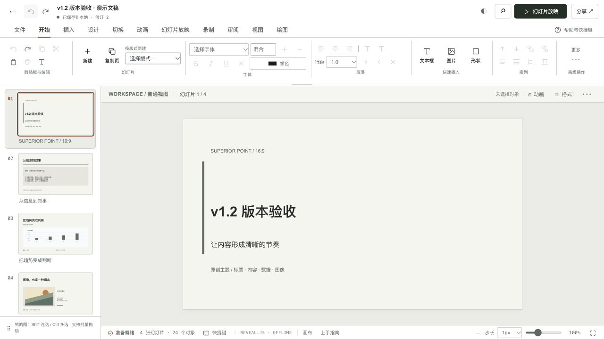

# v1.2 非编辑器资源与版本增补验收

日期：2026-10-12。源码工作区 `/private/tmp/sp-v11-services`，分支 `roadmap/v1.2-theme-resources`。这是 Alpha 增补验收，不代表路线图全量 Beta 或 Stable 完成。

本批交付：本地与云端主题历史版本、固定旧版本详情与显式升级；带授权的独立图片资源读取和哈希核验；元数据目录与每页 24 个预览；兼容诊断 CLI/API；导出 HTML 的减少动态设置。编辑器源码与独立编辑器会话未分配工作。

## 执行证据

所有命令均在上述工作区执行，退出码 0：

| 检查 | 原始记录 | 结果 |
|---|---|---|
| `npm test` | `/private/tmp/sp-v12-remain-js-final.log` | 290 项，289 通过，1 项已有跳过，0 失败；23.76 秒 |
| `npm run test:service` | `/private/tmp/sp-v12-remain-service.log` | 隔离 PostgreSQL 84/84 通过，0 跳过；62.00 秒 |
| `npm run typecheck:service` | `/private/tmp/sp-v12-remain-typecheck.log` | 通过 |
| `npm run build` | `/private/tmp/sp-v12-remain-build-final.log` | 通过 |
| `git diff --check` | 当前增补 diff | 通过 |

新增 9 阶段真实协议验收脚本亦在本机隔离服务通过，结构化原始记录 `/private/tmp/sp-v12-resources-protocol-local.json`；涵盖版本分页、旧快照不变、二进制资产哈希和私有权限、REST/MCP 诊断一致性，所有合成凭证清理成功。

服务测试指向本机 `127.0.0.1:55571/sp_foundation_test`，不使用生产库。最终回归首次受沙箱回环端口监听限制；获准在正常测试环境重跑后取得上述结果。

Codex 内置浏览器在 `http://127.0.0.1:18872/web/` 实际操作：创建个人主题 1.0.0，修改强调色并保存为 1.0.1；历史详情仍显示旧色 `#606760`，新版为 `#185A79`；从旧版本创建四页文稿，再选择新版预览 9 项样式变更，确认保存到修订 1，撤销后重做按钮启用。预览与保存使用正式工作台路径，没有通过脚本改浏览器存储。

实际界面暴露的个人主题 `sourceRef.source` 被误当作资源地址的问题已修复；只有该来源元数据的 `builtin/local/cloud` 枚举可通过，实际资源 `source` 与外部 URL 仍拒绝。相关回归已纳入最终测试。

## 验收边界

用户明确延期离线验收、备份和回滚演练。浏览器工具拒绝 `file://`，自动审批也拒绝把导出件通过本机 HTTP 服务打开，因其构成绕过；这条路径已停止。`/private/tmp/sp-v12-export-evidence/` 中三个 HTML 是导出 API 生成的合成文件，不能作为 UI 下载或离线播放通过证据。

Firefox 独立浏览器、真实 PowerPoint 视觉对照、完整编辑器 Motion Runtime 和真实浏览器千条目录性能仍未验收。千条列表测试证明有界预览读取，不能等同于浏览器耗时或内存测量。部署与公网验证另行记录精确提交、CI 和镜像身份。
