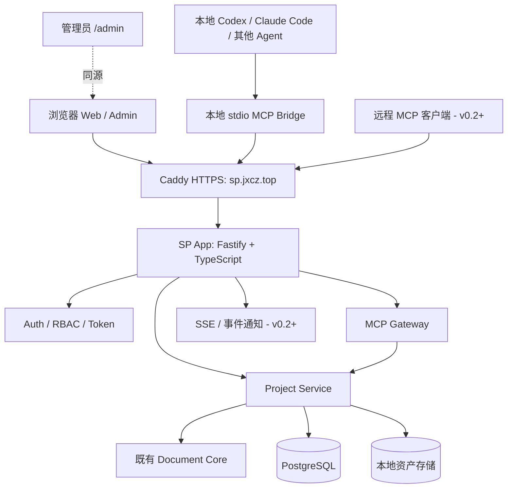

# Superior Point（SP）服务化开发路线图

> **规划版本**：Roadmap v1.0
> **制定日期**：2026-10-11
> **代码仓库**：[J-X-C-Z/Superior-Point](https://github.com/J-X-C-Z/Superior-Point)
> **目标部署服务器**：Hakari
> **正式访问域名**：<https://sp.jxcz.top>
> **项目定位**：AI-Native Presentation Platform —— 浏览器创作 + 统一文档服务 + 本地/远程 MCP + 平台管理后台
> **迭代路径**：`v0.0.1 Preview → v0.1.0 Alpha → v0.2.0 Beta → v0.3.0 Feature Preview → v1.0.0 Stable`
> **文档性质**：开发计划 / 实施指导 / 验收清单。**本文不是已完成或已部署声明**。

---

## 0. 执行摘要

将 Superior Point 从**本地优先的演示文稿工作台**升级为运行在 Hakari 上、可通过 `sp.jxcz.top` 访问的**完整自托管 Web 服务**：

1. **SP Web**：浏览器登录、项目管理、PowerPoint 风格编辑器、云端保存与导入导出。
2. **SP Core / API**：唯一权威文档服务、数据库持久化、修订保护、鉴权与审计。
3. **SP MCP**：本地 Agent 通过 stdio Bridge 访问云端项目；后续提供标准远程 HTTP MCP 授权接入。
4. **SP Admin**：独立 `/admin` 后台，管理用户、项目、Agent 授权、运行状态、审计、配置和备份。
5. **SP Runtime**：Hakari 上的 HTTPS、容器部署、备份、监控、安全更新和恢复能力。

**第一阶段的唯一最优先架构原则：浏览器与 MCP 不再维护相互独立的云端项目库，统一调用 Project Service，并由 PostgreSQL 保存权威项目。** 先实现安全的“浏览器 ↔ Agent 接力编辑”，不要贸然承诺实时多人协同。

### 0.1 完成标志（v0.1.0 Alpha）

- [ ] 通过 `https://sp.jxcz.top` 安全访问服务，并能在 Hakari 重启后恢复。
- [ ] 首个管理员只能通过受保护的初始化流程创建；管理员能创建/禁用普通用户。
- [ ] 普通用户能登录、管理自己的项目并通过现有编辑器云端保存。
- [ ] 其他用户无法凭猜测项目 ID、修改请求参数或 MCP 工具参数跨租户访问数据。
- [ ] 本地 Agent 通过授权的 MCP Bridge 读写**同一份**云端项目。
- [ ] 并发修改遇到冲突时失败关闭或进入恢复流程，不会静默覆盖草稿。
- [ ] `/admin` 至少具备用户、项目、MCP 凭据、审计、系统配置、备份管理与仪表盘。
- [ ] 每日备份和恢复演练通过，具备基本日志、健康检查与上线回滚流程。

---

## 1. 现状基线：已经有的与仍未实现的

### 1.1 已核对的仓库能力（2026-10-11）

| 项目 | 已知现状 | 来源 / 备注 |
|---|---|---|
| 公开发布 | `v0.0.1 Preview` | [README](https://github.com/J-X-C-Z/Superior-Point/blob/main/README.md) |
| 集成编辑器 | `v0.39` 候选适配 | 独立 iframe + postMessage + Core 提交 |
| 技术基础 | Node.js 22+、JavaScript Document Core | [package.json](https://github.com/J-X-C-Z/Superior-Point/blob/main/package.json) |
| 本地项目库 | IndexedDB、自动保存、回收站、单写者租约、冲突保护 | **仅同源浏览器本地存储** |
| 统一核心 | JSON 校验、事务、修订冲突、撤销/重做、快照 | 已实现，但尚未接入云端持久化 |
| 导入与导出 | 可编辑 HTML、JSON 备份、有限的安全渲染 | 完整 HTML 可能包含备注与批注，非脱敏公开版 |
| MCP | **stdio**、8 个工具、本地隔离文件库 | [MCP.md](https://github.com/J-X-C-Z/Superior-Point/blob/main/docs/MCP.md) |
| 渲染 | Reveal.js 5.2.1 与基础静态渲染器 | 高级动画/富文本渲染仍有兼容缺口 |
| 自动化测试 | 127 项：126 通过、1 项有意跳过 | [VALIDATION.md](https://github.com/J-X-C-Z/Superior-Point/blob/main/docs/VALIDATION.md) |
| 真实浏览器验证 | 已覆盖部分 Chrome 编辑/保存/导入/播放路径 | 跨浏览器、完整重启、拖放、复杂 PPTX 尚未完成验收 |

### 1.2 尚未实现，不能当成已交付

- [ ] 平台用户体系、管理员/普通用户登录、生产会话管理。
- [ ] 服务端 Project Service、PostgreSQL 权威文档库与跨设备同步。
- [ ] `/admin` 独立管理后台和管理 API。
- [ ] 面向云端项目的 MCP Bridge、远程 Streamable HTTP MCP、OAuth 授权。
- [ ] 基于账号/Token/项目的服务端访问控制与调用审计。
- [ ] Hakari 生产部署、`sp.jxcz.top` DNS/HTTPS、监控、备份恢复。
- [ ] 完整的观众脱敏导出、成熟的 PPTX 兼容、真正的实时多人编辑。

**重要限制**：当前浏览器 IndexedDB 与 MCP 文件库是两个不同的存储位置，需手动交换 HTML；绝不能将当前本地 stdio MCP 的文件访问行为直接暴露到公网。

---

## 2. 产品边界与角色

### 2.1 三个入口、一个业务核心

| 入口 | 建议路径 | 服务对象 | 主职责 |
|---|---|---|---|
| SP 用户端 | `/`、`/login`、`/app` | 管理员和普通用户 | 创作、项目管理、导入导出 |
| SP Admin | `/admin` | 管理员 | 管理用户、项目、权限、系统与运维 |
| SP MCP | 早期本地 Bridge；后期 `/mcp` | 已获授权的本地/远程 Agent | 读取、验证、修改、导出项目 |
| 共享 API | `/api/v1/*` | Web / Bridge / 系统组件 | 鉴权、文档操作、事务、审计 |

### 2.2 平台角色

- **Admin（管理员）**：管理账号、项目元信息与归属、授权凭据、安全策略、备份、运行状态；可同时使用用户端。
- **User（普通用户）**：管理自己的项目和 Agent 授权；不能访问他人的私人项目或平台管理接口。
- **Project ACL（后期）**：未来引入项目级 Owner / Editor / Viewer；它不同于平台角色。v0.1 先采用项目私有、单一 owner 模型。

> 管理员默认可查看项目**管理元数据**，不应默认读取用户私人文稿内容。紧急排障/恢复访问须有明确流程、最小授权与审计记录。

### 2.3 产品范围控制

**v0.1 必做**：登录与安全、统一文档服务、云端工作台、MCP Bridge、管理后台、部署备份。
**v0.1 不做**：实时多人共编、匿名公开注册、复杂 PPTX 新能力、企业组织/计费、任意服务器脚本执行。
**v0.2 做**：远程 MCP/OAuth、变更通知、历史版本、分享型安全导出、用户体验提升。
**v0.3+ 做**：AI 对象级编辑体验、设计系统、素材库、动画与 PPTX 增强、协作模型。

---

## 3. 建议技术架构

### 3.1 总体拓扑



### 3.2 技术选择与约束

| 模块 | 建议 | 依据和实施注意 |
|---|---|---|
| 服务端 | Node.js + TypeScript + Fastify | 沿用现有 JS 核心；避免一次性重写编辑器 |
| 前端 | 继续使用现有 Web/editor adapter，逐步抽离组件 | v0.1 不以全面换框架为目标 |
| 数据库 | PostgreSQL + 明确版本化 SQL migration（可用 Drizzle） | 事务/用户隔离/修订记录 |
| 文档正文 | PostgreSQL `JSONB` | 保持 canonical 文档结构，服务端验证并迁移 |
| 资产 | Hakari 持久化本地目录 | 按项目隔离、哈希存储；后期视规模换对象存储 |
| 登录 | 用户名/密码 + 服务端可撤销会话 | Argon2id、HttpOnly/Secure Cookie、CSRF/Origin 防护 |
| MCP v0.1 | 本地 stdio Bridge → HTTPS API | 优先兼容现有 Agent 与 8 个工具 |
| MCP v0.2 | Streamable HTTP + 标准 OAuth 授权 | 按实施时的稳定协议和目标客户端核对版本 |
| 通知 | v0.1 简单刷新/轮询；v0.2 SSE | 先保数据一致性，后做低延迟事件通知 |
| 运维 | Docker Compose + Caddy + GitHub Actions | 单服务器易部署、易回滚；不做微服务/K8s |

### 3.3 核心不变量（所有实现必须遵循）

1. `Project Service` 是**所有云端项目写入的唯一入口**；Web、管理员、MCP 均不可绕过它直接写 JSON。
2. 服务端不依赖客户端传入的 `ownerId`、`role`、`isAdmin` 作为信任依据；从身份会话得到 actor。
3. 每次读写使用 `actor + projectId + action` 在服务端重新鉴权，**先鉴权再查阅敏感内容**。
4. 每次修改带 `expectedRevision`，通过事务 CAS 提交；`409 REVISION_CONFLICT` 不重试盲写。
5. 每次成功写入同时完成：保存权威文档、写入修订元信息、记录必要审计事件；失败不得出现半提交。
6. 禁止 Web 与 MCP 各维护一个云端权威库；浏览器 IndexedDB 只做本地项目或明确标注的缓存/草稿。
7. 旧版候选编辑器的整份快照提交暂只允许**单写者**；不可把轮询通知误认为多人实时协作。
8. 备份可恢复性、资产引用完整性和数据迁移回滚与功能代码同等重要。

---

## 4. 账号、权限与安全设计

### 4.1 角色权限矩阵（v0.1）

| 操作 | Admin | User | 未登录 |
|---|:---:|:---:|:---:|
| 浏览产品介绍/公开文档 | ✓ | ✓ | ✓ |
| 登录/退出、修改自己的密码 | ✓ | ✓ | 登录页面 |
| 创建/读取/编辑/删除自己的项目 | ✓ | ✓ | × |
| 读取其他用户的私人项目正文 | 默认 × | × | × |
| 查看所有项目的管理元数据 | ✓ | × | × |
| 创建、禁用和重置普通用户 | ✓ | × | × |
| 改变用户角色、撤销会话 | ✓ | × | × |
| 创建/吊销**自己的** Agent Token | ✓ | ✓ | × |
| 管理所有 Token 的元数据和吊销 | ✓ | × | × |
| 访问 `/admin` 与管理 API | ✓ | × | × |
| 备份管理、系统策略配置 | ✓（需二次验证） | × | × |

### 4.2 登录与账户初始化

- 首次部署使用**服务器端 bootstrap CLI** 创建首个管理员，禁止默认弱密码和公网未认证初始化接口。
- v0.1 默认**关闭公开注册**，由管理员创建用户或发出单次、限时邀请链接。
- 密码使用 Argon2id 哈希；登录限流与统一错误提示避免账号枚举。
- 随机服务端 Session，Cookie 带 `HttpOnly`、`Secure`、适当的 `SameSite`；会话可吊销。
- 写操作使用 CSRF 防护及 Origin 校验，禁止不可信跨域凭据请求。
- 管理员优先支持 TOTP 二次验证；高风险操作须重新认证。
- 禁止删除/禁用最后一个有效管理员；用户禁用后会话与 Token 应失效。

### 4.3 MCP 令牌和授权

- 本地 Bridge 使用高熵**个人访问令牌（PAT）**，仅创建时显示完整值，服务端仅存不可逆验证材料（如安全哈希）及前缀、权限元数据。
- 首批 Scope：`projects:read`、`projects:create`、`projects:write`、`projects:delete`、`projects:export`、`assets:write`。
- Token 绑定主体、到期时间、项目范围、可选允许列表；默认无 `delete` 等高风险权限。
- Bridge 读取 OS 凭据存储或环境变量，**不能把令牌写进示例仓库或日志**。
- `/mcp` 远程客户端在 v0.2 引入 OAuth 2.1（授权码 + PKCE）、发现元数据、客户端兼容验证、精确的资源/Scope 授权。
- 所有 MCP 工具调用必须经 `Project Service` 进行**项目级鉴权与修订检查**。

### 4.4 安全硬约束

- 防止 IDOR/BOLA：不可通过调换 `projectId`、`userId`、`assetId` 绕过权限。
- 防止 XSS/HTML 注入：编辑器隔离、导入结构校验、导出使用受信任运行时并脱敏。
- 防止路径穿越：服务器资产/导出目标不能接受任意文件路径；Bridge 本地文件只作用于显式授权根目录。
- 上传限定 MIME/大小/内容检查、限制压缩包解压大小、禁止不受信任的脚本执行与服务端任意外链抓取。
- 生产日志不得包含口令、Cookie、Bearer Token、文稿正文；API 限流、请求体上限、健康检查最小披露。
- Admin 的“运行操作”只允许预定义运维任务，**绝不提供网页任意 Shell 命令执行**。

---

## 5. 数据模型与一致性

### 5.1 v0.1 推荐核心表

| 表 | 核心字段（建议） | 用途 |
|---|---|---|
| `users` | `id`, `username`, `password_hash`, `role`, `status`, `created_at` | 账号与平台角色 |
| `sessions` | `id`, `user_id`, `session_hash`, `expires_at`, `revoked_at` | 浏览器会话 |
| `projects` | `id`, `owner_id`, `title`, `revision`, `document_jsonb`, `deleted_at`, `updated_at` | 当前权威文档 |
| `project_revisions` | `project_id`, `revision`, `actor_id`, `source`, `snapshot_ref`, `created_at` | 修订历史、追溯与恢复 |
| `project_locks` | `project_id`, `holder`, `fencing_token`, `expires_at` | 临时单写者租约 |
| `api_tokens` | `id`, `user_id`, `token_hash`, `scopes`, `project_allowlist`, `expires_at`, `revoked_at` | 本地 Agent 凭据 |
| `assets` | `id`, `owner_id`, `project_id`, `sha256`, `mime_type`, `size`, `storage_key` | 素材元数据 |
| `audit_logs` | `actor_id`, `action`, `resource_type`, `resource_id`, `outcome`, `created_at` | 审计 |
| `system_settings` | `key`, `value`, `updated_by`, `updated_at` | 非机密可编辑配置 |
| `export_jobs` | `id`, `user_id`, `project_id`, `format`, `status`, `result_key` | 导出任务 |
| `backup_jobs` | `id`, `initiator_id`, `status`, `manifest_key`, `completed_at` | 备份记录 |
| `mutation_receipts` | `project_id`, `actor_id`, `client_mutation_id`, `result_revision` | 请求去重/幂等性 |

**扩展表（v0.2+）**：`project_members`、`oauth_clients`、`oauth_grants`、`oauth_tokens`、`notifications` 等。

### 5.2 文档写入协议

建议 HTTP API：

```http
PATCH /api/v1/projects/{projectId}/document
Content-Type: application/json

{
  "expectedRevision": 12,
  "clientMutationId": "client-generated-unique-id",
  "operations": [
    {"type": "updateElement", "slideId": "slide-1", "elementId": "title", "patch": {"text": "Superior Point"}}
  ]
}
```

> 以上是拟议接口示意。`operations` 的最终字段以现有 Core 操作定义为准，不能用此示例替代实际 schema。

服务端写入步骤：

1. 鉴权、检查 `projects:write`、租约与大小限制。
2. 检查 `clientMutationId` 是否已提交（返回原结果避免重复执行）。
3. 事务锁定当前项目行，检查 `expectedRevision`。
4. 用 `Document Core` 验证并执行操作，得到新文档和递增修订号。
5. 原子写入当前文档、修订记录、幂等收据和必要审计信息。
6. 返回新修订号与安全的结果摘要；发布更新事件（事件丢失不能影响事务正确性）。
7. 冲突返回 `409 REVISION_CONFLICT`，占用返回可重试的 `PROJECT_BUSY`，客户端先拉取最新修订再决定恢复/合并。

### 5.3 浏览器与 Agent 接力编辑

- 浏览器取得写入租约→正在编辑→自动保存→释放/转为只读。
- Agent 申请写入→若租约被占用，则 `PROJECT_BUSY`，不得抢占未落盘草稿。
- 用户明确选择“交给 AI”时，浏览器先 `flush()`、确认云端持久提交后移交写权。
- Agent 成功修改后，浏览器重新读取最新修订；本地未保存草稿进入独立恢复分支而不是被覆盖。
- v0.2+ 加 SSE 提示最新修订并支持自动安全刷新；**不**等于共同操作同一活动画布。
- 真正的增量对象级多人/人机同时编辑放在 v0.3+ 技术评估之后。

### 5.4 本地项目迁移与离线能力

- 保留 IndexedDB，区分 `Local Project` / `Cloud Project` / `Unsynced Draft` 三种状态。
- 提供“检测本地项目 → 用户选择 → 校验 → 上传 → 回读比对 → 标记完成”的迁移向导。
- 项目 ID 冲突时重新分配云端 ID 并保存来源映射；不得覆盖同名/同 ID 既有项目。
- 迁移成功后**保留本地数据**，清理必须由用户单独确认。
- 云端编辑时断网保留本地恢复草稿，界面明确区分“已保存到云端”和“仅保存在本地”。
- 继续支持完整可编辑 HTML 与 JSON 备份；另实现**无备注/批注/历史/凭据的公开演示 HTML**，其可编辑性和信息保留范围需明确告知。

---

## 6. 管理后台（SP Admin Console）详细范围

**地址**：`https://sp.jxcz.top/admin`。与主站统一登录，但使用独立导航、页面和管理 API；后端每次校验 Admin 权限。

### 6.1 信息架构

```text
/admin
├── dashboard                  平台概览、告警和最近活动
├── users                      用户列表、创建、禁用、重置、会话
├── projects                   项目元数据、归属、回收站、诊断
├── mcp
│   ├── service                服务状态、工具、协议、兼容性
│   ├── connections            Agent 授权记录/最近调用
│   ├── tokens                 Token 元数据、限权与吊销
│   └── logs                   MCP 工具调用与失败分析
├── monitoring
│   ├── infrastructure         Hakari CPU/内存/磁盘/网络
│   ├── application            API、数据库、任务、错误率
│   └── storage                数据库、素材、备份占用
├── backups                    备份任务、验证与恢复演练
├── audit                      安全/管理事件检索
└── settings
    ├── general                名称、品牌、公告
    ├── accounts               注册策略、账号和配额
    ├── security               会话、登录限制、2FA
    ├── mcp                    MCP 功能开关、配额、策略
    ├── storage                上传大小、留存期限
    └── features               实验功能、维护模式
```

### 6.2 模块与最低验收要求

| 模块 | v0.1 P0 范围 | v0.2 P1 增强 | 安全边界 |
|---|---|---|---|
| 仪表盘 | 用户/项目/空间统计、服务在线状态、最近事件 | 历史趋势、耗时/错误率图表 | 聚合统计不暴露私人正文 |
| 用户管理 | 创建、禁用、重置邀请、角色、退出会话 | 批量导入/批处理 | 防最后管理员失效；高危操作二次确认 |
| 项目管理 | 项目元数据、所属用户、回收站、归属纠正 | 更深的校验诊断、恢复向导 | 不默认读取他人内容 |
| MCP 管理 | PAT 元数据、Scope、到期、吊销、日志 | OAuth 客户端/授权管理与统计 | 仅展示令牌前缀，不展示明文 |
| 系统设置 | 网站公告、邀请码/注册策略、配额、开关 | 更细粒度策略、维护模式 | 机密只能从环境/密钥管理读取 |
| 审计日志 | 登录、角色、Token、项目、设置、恢复操作 | 风险规则/聚合告警 | 追加写入、防普通后台篡改 |
| 数据维护 | 备份状态、执行备份、查看恢复演练结果 | 可控恢复工作流、空间清理 | 恢复高危操作需二次认证 |
| Hakari 监控 | 最低健康检查与用量概要 | CPU/内存/磁盘/API/DB/任务图表 | 只读指标，不暴露任意 Shell |

### 6.3 管理 API（建议契约）

| 方式 | 路径 | 作用 |
|---|---|---|
| `GET` | `/api/v1/admin/overview` | 平台概览 |
| `GET / POST` | `/api/v1/admin/users` | 用户列表 / 创建 |
| `PATCH` | `/api/v1/admin/users/:id` | 用户状态/资料/角色 |
| `POST` | `/api/v1/admin/users/:id/revoke-sessions` | 撤销会话 |
| `GET` | `/api/v1/admin/projects` | 项目管理列表 |
| `POST` | `/api/v1/admin/projects/:id/restore` | 回收站恢复 |
| `GET` | `/api/v1/admin/mcp/tokens` | Token 元数据检索 |
| `POST` | `/api/v1/admin/mcp/tokens/:id/revoke` | 强制吊销 |
| `GET` | `/api/v1/admin/mcp/logs` | MCP 调用审计 |
| `GET` | `/api/v1/admin/system/health` | 服务健康信息 |
| `GET / PATCH` | `/api/v1/admin/settings` | 系统配置 |
| `GET` | `/api/v1/admin/audit-logs` | 审计检索 |
| `GET / POST` | `/api/v1/admin/backups` | 备份列表 / 发起 |

所有管理 API 需分页、输入校验、最小化响应字段、受控错误信息、服务端审计与端到端权限测试。

### 6.4 UI 设计

- 延续 SP 的 **Noema** 设计语言；管理端采用左侧导航、顶部全局搜索、主面板、详情抽屉的高效率桌面布局。
- 信息密度高于编辑器首页，但统计层级、表格操作、危险操作反馈必须清楚。
- 管理平台需要键盘可访问性、清晰的加载/空白/失败状态；小屏支持基础管理操作。
- 管理能力不得仅由 UI 隐藏控制；后端 RBAC 是真实边界。

---

## 7. MCP 能力与 API 清单

### 7.1 保留并迁移的 8 个现有 MCP 工具

| 工具 | 当前行为 | 云端改造目标 |
|---|---|---|
| `sp_create_project` | 本地文件库创建项目 | 使用登录用户上下文创建云端项目 |
| `sp_open_project` | 按 ID 打开，或导入本地 HTML | 项目读取交给 Project Service；本地导入归 Bridge 管理 |
| `sp_get_document` | 获取概要或全文 | 按项目 ACL 读取云端文档 |
| `sp_get_slide` | 获取页面内容 | 返回授权项目指定页面及修订号 |
| `sp_edit` | CAS 原子提交本地文件 | 调用服务端事务写入与冲突处理 |
| `sp_render_slide` | 返回静态 SVG 与缺口说明 | 对授权项目渲染，不夸称与完整动画一致 |
| `sp_validate` | 文档结构/兼容检查 | 使用云端文档进行验证 |
| `sp_save_export` | 保存 HTML 到授权本地目录 | 云端生成导出结果；本地 Bridge 仅在授权目录保存下载文件 |

### 7.2 建议新增工具

| 工具 | 版本 | 作用 |
|---|---|---|
| `sp_list_projects` | v0.1 | 列出当前用户可访问项目 |
| `sp_get_project_info` | v0.1 | 项目基本信息 |
| `sp_list_slides` | v0.1 | 结构化页面列表 |
| `sp_duplicate_project` | v0.2 | 复制项目 |
| `sp_get_revision_history` | v0.2 | 获取可恢复修订 |
| `sp_restore_revision` | v0.2 | 以新修订形式恢复历史版本 |
| `sp_import_html` | v0.2 | 安全导入可编辑 HTML |
| `sp_export_project` | v0.2 | 返回受限时效下载资源 |
| `sp_get_assets` / `sp_upload_asset` | v0.2 | 管理授权项目的素材 |
| `sp_apply_theme` | v0.3 | 使用结构化设计系统主题 |
| `sp_get_render_diagnostics` | v0.3 | 诊断表现差异 |

### 7.3 远程 MCP 路线（v0.2）

1. 核对实施时的 MCP 稳定协议和目标客户端兼容性，保留现有 stdio 客户端测试。
2. 采用 Streamable HTTP 作为远程传输；不开放匿名工具调用。
3. 使用成熟、受维护的 OAuth/OIDC 方案构建 OAuth 2.1 授权流程与发现元数据；不自行随意拼装授权协议。
4. 客户端获得限定 Scope/项目范围的凭据；Token 生命周期可管理和撤销。
5. 审核 HTTP 层 Origin、授权受众、重放、限流、请求体限制、日志脱敏。
6. 对新旧目标客户端各进行真实连接、授权、读/写、撤销、冲突测试。

---

## 8. Hakari 部署与运行

### 8.1 单机初始部署

```text
Hakari
├── Caddy（仅此层公网暴露 80/443）
│   └── sp.jxcz.top → sp-app:3000
├── sp-app（Web、API、Auth、Project、可选 MCP HTTP）
├── PostgreSQL（仅容器私网访问）
└── 持久化卷
    ├── database
    ├── assets
    ├── exports
    └── backups
```

- 正式域名仅采用 `https://sp.jxcz.top`；DNS A/AAAA 或安全隧道方案取决于 Hakari 实际公网可达性。
- Caddy 自动 HTTPS 需满足域名、入口端口/证书挑战等条件；不可未经核实就宣称已签发成功。
- 初版无需 Redis、Kubernetes、专用队列或 MinIO；有性能瓶颈后再增加。
- 服务容器最小权限、非 root 运行、持久化卷独立、PostgreSQL 不发布公网端口。

### 8.2 推荐部署文件组织

```text
/opt/superior-point/
├── compose.yaml
├── Caddyfile
├── .env                     # 禁止进入 Git
├── data/
│   ├── postgres/
│   ├── assets/
│   └── exports/
├── backups/
└── scripts/
    ├── bootstrap-admin.sh
    ├── backup.sh
    ├── restore.sh
    └── health-check.sh
```

### 8.3 部署前核查项（目前未知，不可假设已满足）

- [ ] Hakari CPU、内存、磁盘空间及备份空间。
- [ ] 操作系统、架构、Docker Engine / Compose 版本。
- [ ] 是否有公网 IPv4/IPv6，80/443 入站是否通畅，是否需要 Tunnel。
- [ ] `sp.jxcz.top` 的 DNS 管理权限、记录现状和 DNS 传播状态。
- [ ] 防火墙、系统更新、SSH 密钥、非 root 管理账号等基础安全。
- [ ] 数据目录挂载、权限、文件系统稳定性及恢复目标位置。

### 8.4 CI/CD 与备份

- PR 触发静态检查、单元/集成/安全/浏览器冒烟测试；禁止未经验证的主分支直接生产构建。
- 镜像使用明确版本或 digest，不在生产环境直接使用不可追踪的 `latest`。
- 先迁移兼容性检查，再升级服务；保留上一镜像与恢复方案。
- 每日备份 PostgreSQL 与素材，记录校验 manifest；加密复制至少一份至 Hakari 外部。
- 定期从备份恢复到隔离环境，检查项目数量、样本数据、资产引用和账号登录。
- 备份失败、安全认证异常、磁盘容量不足、数据库不可用必须产生可见告警。

---

## 9. 里程碑与优先级

**任务优先级**：`P0` = v0.1 上线阻断；`P1` = 下一阶段重要能力；`P2` = 体验/竞争力增强。
**状态默认**：所有任务均为 `待开发`，除非合并代码、实测通过并补充验收证据。
**阶段推进方式**：按照验收门槛推进，不承诺固定工期；允许在冻结接口后多工作组并行。

### 9.1 v0.1.0 Alpha：可登录、可保存、可由 Agent 访问、可管理的服务

| ID | 工作项 | 优先级 | 主要前置依赖 | 可验证完成标准 |
|---|---|---|---|---|
| SP-001 | 服务架构、边界、OpenAPI/契约定稿 | P0 | 现有 Core/编辑器/MCP 清点 | API/身份/错误码/数据 schema 有版本化说明 |
| SP-002 | PostgreSQL 数据模型与 migration | P0 | SP-001 | 全新建库、升级、失败处理通过 |
| SP-003 | Project Service：项目 CRUD、鉴权入口 | P0 | SP-001/002 | 同一服务层被 Web/MCP 调用 |
| SP-004 | 服务端 Document Core 事务集成 | P0 | SP-002/003 | CAS、原子操作、恢复与冲突测试通过 |
| SP-005 | 登录、退出、Session、密码安全 | P0 | SP-002 | 账号登录、撤销会话和限流有效 |
| SP-006 | Admin/User RBAC 与项目隔离 | P0 | SP-003/005 | 跨用户读写、猜 ID、伪造角色全部拒绝 |
| SP-007 | 管理员 bootstrap 与账号管理基础 | P0 | SP-005/006 | 可安全创建首个 Admin 与普通 User |
| SP-008 | 浏览器云端存储适配与保存状态 | P0 | SP-003/004/006 | 云端保存/刷新/跨设备读取正确 |
| SP-009 | IndexedDB 项目迁移向导 | P0 | SP-008 | 迁移、冲突处理、回读、失败恢复通过 |
| SP-010 | 本地 stdio MCP Bridge | P0 | SP-003/004/006/011 | Agent 在服务器授权项目执行读取/编辑 |
| SP-011 | PAT、Scope、项目绑定与撤销 | P0 | SP-005/006 | 到期/吊销/越权/错误 Scope 请求被拒绝 |
| SP-012 | 修订冲突、租约与恢复流程 | P0 | SP-004/008/010 | 双写无静默覆盖、草稿可恢复 |
| SP-013 | Docker Compose、构建和部署脚本 | P0 | SP-002/003/005 | Hakari 或等价干净环境可重复部署 |
| SP-014 | 域名、HTTPS、反向代理与安全头 | P0 | SP-013、Hakari 网络/DNS | `sp.jxcz.top` HTTPS 可用；DB 不公网暴露 |
| SP-015 | 健康检查、备份、恢复与日志 | P0 | SP-002/013 | 有异地备份，完整恢复演练通过 |
| SP-016 | 端到端、安全与发布验收 | P0 | v0.1 全部 P0 | 见 §10 发布门槛，附可复现证据 |
| SP-029 | `/admin` 前端基础框架与路由 | P0 | SP-001/005/006 | Admin 可进、User/访客被禁止 |
| SP-030 | 后台权限中间件和高风险操作守卫 | P0 | SP-005/006/029 | 管理 API 逐项拒绝越权请求 |
| SP-031 | 用户管理完整操作 | P0 | SP-007/029/030 | 创建/禁用/角色/会话/重置可用 |
| SP-032 | 项目管理、元数据、回收站与恢复 | P0 | SP-003/006/029/030 | 管理元数据、恢复与审计正常 |
| SP-033 | MCP Token 管理后台 | P0 | SP-011/029/030 | 管理员能查看元数据和强制吊销 |
| SP-034 | 管理审计日志 | P0 | SP-005/006/030 | 高危操作记录 actor/target/outcome |
| SP-035 | 管理系统设置、策略与功能开关 | P0 | SP-029/030/034 | 授权修改受控、机密不回显 |
| SP-036 | 后台概览 Dashboard | P0 | SP-002/029/030 | 用户/项目/空间/基础健康有数据 |
| SP-037 | 备份执行及恢复状态管理 | P0 | SP-015/029/030/034 | 后台可发起受控备份并查看验证结果 |

**v0.1 发布门槛**：上述所有 P0 任务均交付；允许隐藏尚未实现的远程 `/mcp` 入口和高级监控图表，不允许伪装为可用。

### 9.2 v0.2.0 Beta：标准远程 MCP 与更成熟的用户体验

| ID | 工作项 | 优先级 | 前置依赖 | 验收标准 |
|---|---|---|---|---|
| SP-017 | MCP SDK 迁移与双端兼容测试 | P1 | SP-010/016 | 8 个老工具行为稳定，新 SDK/协议通过 |
| SP-018 | Streamable HTTP MCP | P1 | SP-017/011 | 远程客户端能安全连接并调用授权工具 |
| SP-019 | OAuth 2.1 授权集成 | P1 | SP-005/011/018 | PKCE、Scope、撤销与回调校验通过 |
| SP-020 | MCP 用户授权与连接页面 | P1 | SP-019/029 | 授权提示可解释、可查看、可撤销 |
| SP-021 | Agent 管理中心及连接记录 | P1 | SP-011/018/020/033 | 用户能查看 Agent 授权和调用元数据 |
| SP-022 | SSE 项目变更通知 | P1 | SP-004/012 | Agent 修改后浏览器可靠提示或安全刷新 |
| SP-023 | 历史版本浏览与恢复 | P1 | SP-004/012 | 历史恢复生成**新修订**，不回退计数器 |
| SP-024 | 独立的观众脱敏 HTML 导出 | P1 | SP-008、现有 IO | 公开导出不携带私有备注/历史/凭据 |
| SP-025 | 编辑器同步、恢复与状态 UI 精修 | P1 | SP-008/012/022 | 保存/冲突/断线反馈清楚且不会丢草稿 |
| SP-026 | 管理后台体验精修 | P1 | SP-029~037 | 搜索筛选、批量确认、错误状态与易用性 |
| SP-027 | 手机端浏览与基础项目操作 | P1 | SP-008/025 | 小屏登录、查看、基础项目操作可用 |
| SP-028 | 用户/管理员/MCP/API 文档完善 | P1 | 各 Beta 功能 | 新用户可依文档完成接入与常见恢复 |
| SP-038 | Hakari 运行监控面板 | P1 | SP-015/036 | CPU/内存/磁盘/API/DB 指标真实且只读 |
| SP-039 | MCP 调用分析与异常诊断 | P1 | SP-018/021/034 | 失败率、工具调用、耗时与错误聚合可查看 |
| SP-040 | 系统公告、通知和维护模式 | P1 | SP-035/036 | 维护信息清晰，管理操作留审计 |

**v0.2 发布门槛**：不同客户端的 MCP 授权、读取、编辑、吊销测试通过；通知与历史恢复无数据丢失；管理后台具备可用的运营观测能力。

### 9.3 v0.3.0 Feature Preview：AI-Native 设计与编辑体验

| ID | 工作项 | 优先级 | 前置依赖 | 验收标准 |
|---|---|---|---|---|
| SP-041 | AI 操作增量化与受控变更预览 | P2 | SP-022/023/025 | 用户能识别 Agent 修改对象并审查 |
| SP-042 | 接入 Design Systems 主题规范 | P2 | SP-004/024 | 主题有结构化 Token、可迁移、可编辑 |
| SP-043 | 模板与版式系统 | P2 | SP-042 | 新建文稿可应用并修改模板 |
| SP-044 | 动画时间线、遮罩、转场完善 | P2 | 编辑器功能验收 | 主流动画可预览、可保存、可导出 |
| SP-045 | 图片、图表与媒体素材库 | P2 | SP-008/资产服务 | 引用正确、上传安全、配额可控 |
| SP-046 | PPTX 导入导出与兼容性测试 | P2 | 编辑器/导出适配 | 给出可复现的格式兼容清单 |
| SP-047 | 从大纲生成页面、结构化 AI 编辑 | P2 | SP-041~043 | 产物可继续手动编辑、可撤销 |
| SP-048 | 对象级操作合并与协作技术验证 | P2 | SP-041 | 冲突策略和原型经过并发测试 |

**v0.3 原则**：先建立对象级操作及兼容性测试，再考虑 CRDT/OT/Yjs 等复杂协作方案；不应直接给 v0.39 快照桥接加“多人编辑”标签。

### 9.4 v1.0.0 Stable：生产稳定和长期可维护

| ID | 工作项 | 优先级 | 验收标准 |
|---|---|---|---|
| SP-049 | 生产级可靠性、安全与性能专项 | P0（发布门槛） | 高危安全问题清零；备份恢复及负载测试通过 |
| SP-050 | 生产发布规范与长期维护体系 | P0（发布门槛） | 版本/升级/迁移/回滚/变更记录/维护文档齐全 |

**v1.0 发布门槛**：用户可以长期自助使用；管理员无需开发者介入即可完成日常运营；备份恢复、迁移升级、安全隔离和核心编辑链路均有真实生产近似环境验收证据。无需强制将所有 P2 功能视为 v1.0 阻断项，按实际质量目标收敛。

---

## 10. 测试矩阵与验收门槛

### 10.1 P0 端到端场景

| 场景 | 检查点 | 判定 |
|---|---|---|
| 首次部署 | 干净环境可建库、初始化 Admin、启动 HTTPS | 必须通过 |
| 登录安全 | 正确/错误密码、限流、会话撤销、Cookie、CSRF | 必须通过 |
| 角色隔离 | 普通 User 请求任意 Admin 页面/API | 必须拒绝 |
| 项目隔离 | User B 直接访问 User A 的项目/资产/导出 | 必须拒绝 |
| CRUD | 新建/重命名/删除/恢复项目 | 必须通过 |
| 编辑保存 | 文字/形状编辑、自动保存、刷新重开 | 必须无丢失 |
| 跨设备 | 不同浏览器会话登录同一账号读取文档 | 必须通过 |
| 离线草稿 | 模拟断网、超时、重连、退出 | 不得误报已云端保存 |
| 并发 CAS | 两端持旧修订同时写入 | 后写被拒或安全恢复 |
| 不确定提交 | 断网发生在事务提交后 | 幂等重试不能重复执行 |
| MCP 授权 | 有权限的 Agent 读取、修改、验证 | 必须通过 |
| MCP 吊销 | PAT 禁用/过期/错误 Scope | 必须拒绝 |
| MCP 与 Web 同库 | Agent 修改后 Web 回读 | 文档和修订一致 |
| MCP 本地安全 | 路径穿越、符号链接、越权目录访问 | 必须拒绝 |
| HTML 导入 | 恶意脚本、越限文件、损坏 JSON、未知版本 | 不执行脚本、不覆盖原项目 |
| 完整导出 | 可编辑 HTML 离线运行并重新导入 | 明确保留/缺失字段 |
| 后台用户管理 | 创建、禁用、修改角色、撤销会话 | 必须通过且有审计 |
| 后台数据管理 | 项目元数据、回收站、恢复与权限 | 必须通过且不默认泄露正文 |
| 后台高危操作 | 角色变更、Token 吊销、备份 | 额外确认/审计有效 |
| 重启 | 重启 App/DB 容器之后项目完整 | 必须通过 |
| 恢复演练 | 从备份恢复数据库与图片并核对 | 必须通过 |

### 10.2 遗留编辑器验收不得遗漏

- [ ] Chrome、Edge、Firefox 的主要编辑/导出流程。
- [ ] 页面拖动/缩放/旋转、选择区域、文字输入、剪贴板。
- [ ] 实际浏览器完全退出、系统/服务器重启后再打开。
- [ ] 多标签编辑控制及恢复副本行为。
- [ ] 本地图片插入、资源持久化与重打开。
- [ ] Reveal.js 放映、动画时间线、HTML 导出呈现差异。
- [ ] PPTX 导入/导出兼容性**仅按经过验证的范围声明支持**。
- [ ] iframe 安全限制下的权限行为（剪贴板、录制、下载等）。

### 10.3 Definition of Done（每项任务通用）

一个任务只有同时满足以下条件才能标为“完成”：

1. 实现与版本化接口、数据迁移或行为说明已提交。
2. 关键正向/异常/权限路径有自动测试或可复现验收证据。
3. 相关日志和用户可见错误信息不泄漏敏感数据。
4. 遇到失败能重试或恢复，且不会静默丢弃数据。
5. 新能力在对应环境实测；模拟环境通过不等于生产真实通过。
6. 使用文档、部署文档或变更记录已更新。
7. 相关依赖任务的接口兼容、代码已合并并通过 CI。

---

## 11. 建议实施顺序与并行开发分组

### 11.1 关键路径（优先执行）

```text
已有 Document Core / v0.39 / MCP
                │
                ▼
       SP-001 统一契约
          ┌─────┴─────┐
          ▼           ▼
   SP-002 DB     API 语义与鉴权设计
          │           │
          ▼           ▼
   SP-003/004      SP-005/006
     Project       Auth/RBAC
       Service        │
          └─────┬────┘
                │
      ┌─────────┼────────────┐
      ▼         ▼            ▼
  SP-008 Web  SP-011 PAT  SP-029 Admin
      │         │            │
  SP-009/012 SP-010       SP-030~037
      └─────────┼────────────┘
                ▼
     SP-013~015 Hakari 运行
                │
                ▼
         SP-016 验收发布
```

### 11.2 并行工作组

| 工作组 | 主任务 | 共享交付边界 |
|---|---|---|
| 核心与数据库组 | SP-001~004、012 | API 契约、事务、Document Core 适配 |
| 账号与安全组 | SP-005~007、011、030、034 | Actor、RBAC、会话/Token、审计中间件 |
| Web 编辑器组 | SP-008/009、025 | CloudProjectStore 适配、迁移、编辑状态 |
| MCP 组 | SP-010、017~021 | Bridge、工具兼容、Remote MCP、OAuth |
| 后台组 | SP-029、031~037、038~040 | Noema Admin 前端与管理 API |
| 部署与验收组 | SP-013~016、028、049~050 | Hakari 部署、备份、CI、E2E、安全验收 |

**协作规则**：

- SP-001 的 API/schema 锁定后再并行，禁止多个工作组私自定义另一套 `projectId`、revision 或权限语义。
- 使用独立分支和小 PR；每个 PR 要附对应任务编号、自动测试、前后兼容及迁移风险。
- 先跑现有基线测试，避免新服务化改造破坏历史编辑器与 MCP 的既有能力。
- 数据库 migration、身份与权限、Document Core 改动必须由核心负责人重点复核。
- 可以借助 Paperclip 协调开发与验收，但**完成状态以代码、测试与真实部署证据为准**。

### 11.3 最小纵向切片（建议首个合并链路）

1. PostgreSQL 建立一个普通用户与项目。
2. 用户登录后 `POST /api/v1/projects` 创建云端文档。
3. 浏览器读取 canonical JSON，执行一次 Core 编辑提交。
4. 使用同一身份主体授权的测试 MCP Bridge 读取并执行一次 `sp_edit`。
5. 浏览器刷新确认同一文档内容和修订号变化。
6. 由第二个用户验证无法访问前一用户的文档。

**先跑通这条链路，再扩充管理后台和完整编辑功能。** 这能最早验证架构是否真正统一。

---

## 12. 建议目录演进（增量改造）

```text
Superior-Point/
├── core/                      # 保留既有 Document Core
├── web/                       # 既有首页与 editor adapter
│   ├── auth/                  # 新增：登录入口
│   ├── settings/              # 新增：用户/Agent 设置
│   └── admin/                 # 新增：独立管理后台
├── storage/
│   ├── ...                    # 保留 IndexedDB
│   └── cloud-project-store.js # 新增：云端项目适配
├── server/                    # 新增：业务服务
│   ├── app.ts
│   ├── auth/
│   ├── routes/
│   ├── services/
│   │   ├── project-service.ts
│   │   ├── document-service.ts
│   │   ├── asset-service.ts
│   │   └── export-service.ts
│   ├── db/
│   └── middleware/
├── mcp/
│   ├── server.js              # 保留原 stdio 文件模式
│   ├── bridge/                # 新增：连接云端 API 的本地桥
│   └── remote/                # v0.2：远程 HTTP MCP
├── deploy/hakari/
│   ├── compose.yaml
│   ├── Caddyfile
│   └── scripts/
├── tests/
│   ├── core/
│   ├── api/
│   ├── auth/
│   ├── mcp/
│   ├── admin/
│   ├── security/
│   └── e2e/
└── docs/
    ├── architecture/
    ├── api/
    ├── mcp/
    ├── admin/
    └── deployment/
```

目录为**目标结构示意**，不是当前实际目录清单。应根据已有构建工具和引用路径逐步迁移，不要因美化目录而大范围改动已稳定模块。

---

## 13. 风险登记与缓解策略

| 风险 | 影响 | 缓解措施 | 发布阻断 |
|---|---|---|---|
| v0.39 快照编辑与 Agent 并发覆盖 | 丢文档/丢草稿 | 单写者租约、CAS、明确移交与恢复副本 | 是 |
| Web 和 MCP 维护两份库 | 数据不一致 | 唯一 Project Service、统一 PostgreSQL | 是 |
| 跨账号 IDOR/BOLA | 用户数据泄漏 | 每个 API/工具独立鉴权、跨租户 E2E | 是 |
| 令牌泄漏或过度授权 | Agent 可越权操作 | 哈希存储、Scope、项目绑定、过期与吊销 | 是 |
| HTML/素材导入执行不可信内容 | XSS/服务端攻击 | 隔离、严格校验、资源策略、恶意文件测试 | 是 |
| 本地迁移丢失复杂编辑器数据 | 不可逆损坏 | 无损保留、回读比对、失败不删旧数据 | 是 |
| 浏览器显示“已保存”但云端失败 | 用户误判 | 清楚区分云端持久化与草稿状态 | 是 |
| Hakari 网络/存储条件与假设不符 | 无法部署/备份 | 先做部署环境核查，不臆造机器规格 | 是 |
| 仅本机备份、无法恢复 | 灾难性丢失 | 离机加密备份、定期隔离恢复演练 | 是 |
| MCP 协议/客户端兼容变化 | 无法连接 Agent | 跟踪稳定规范、真实客户端回归、保留 stdio | v0.2 是 |
| PPTX/高级动画表现差异 | 作品保真不足 | 分级兼容报告，不误报“完全支持” | 按承诺范围 |
| 一次性前端重写 | 进度拖延、回归风险 | 渐进式改造，先完成服务纵向切片 | 建议禁止 |
| 管理后台成为服务器远程执行入口 | 主机沦陷风险 | 仅可执行预定义受控任务，不提供 Shell | 是 |

---

## 14. 对外 API 最小资源划分（规划）

| 资源 | 建议端点 | 版本 |
|---|---|---|
| 身份 | `POST /api/v1/auth/login`、`POST /api/v1/auth/logout`、`GET /api/v1/auth/me` | v0.1 |
| 用户项目 | `GET/POST /api/v1/projects`、`GET/PATCH/DELETE /api/v1/projects/:id` | v0.1 |
| 文档编辑 | `GET /api/v1/projects/:id/document`、`PATCH .../document` | v0.1 |
| 幻灯片 | `GET /api/v1/projects/:id/slides/:slideId` | v0.1 |
| 导入 | `POST /api/v1/projects/import` | v0.1 |
| 导出 | `POST /api/v1/projects/:id/exports` | v0.1（已有格式） |
| Agent 凭据 | `GET/POST /api/v1/me/tokens`、`DELETE /api/v1/me/tokens/:id` | v0.1 |
| 管理后台 | `/api/v1/admin/*` | v0.1 |
| 系统健康 | `/health/live`、`/health/ready`（后者限权） | v0.1 |
| 修订历史 | `GET /api/v1/projects/:id/revisions`、恢复接口 | v0.2 |
| 远程 MCP | `POST /mcp` 等协议规定入口 | v0.2 |
| OAuth | 标准 OAuth/OIDC 元数据与授权接口 | v0.2 |

注意 `PATCH /document` 优先使用**结构化受控操作**。当前 v0.39 候选的 `replaceContent` 快照桥接可作为受控过渡，但必须通过项目锁、权限校验和预期修订机制，不可允许任意全量覆盖。

---

## 15. 近期开发待办（可直接转换 GitHub Issues / Paperclip 任务）

### 第 1 批：冻结基础契约

- [ ] **SP-001** 输出 `docs/architecture/service-boundaries.md`、`docs/api/openapi.yaml`、错误码规范和角色矩阵。
- [ ] **SP-002** 输出数据库 migration、种子测试数据、数据库初始化/回滚验证脚本。
- [ ] **SP-005/006** 输出账号模型、RBAC 授权中间件、登录风控与跨用户测试。
- [ ] **SP-003/004** 输出 Project Service 最小 CRUD + `expectedRevision` CAS 事务。

### 第 2 批：最小可用闭环

- [ ] **SP-008** 将工作台一个项目的存储替换为云端适配，保留本地模式切换。
- [ ] **SP-011/010** 实现 PAT 与一个端到端可运行的 MCP Bridge 客户端。
- [ ] **SP-012** 测试浏览器 ↔ Agent 接力编辑的冲突和恢复。
- [ ] **SP-007** 管理员 bootstrap 及普通用户账号创建。

### 第 3 批：独立管理后台

- [ ] **SP-029/030** 建立 `/admin` 路由、后台骨架和服务端权限守卫。
- [ ] **SP-031/032** 用户管理与项目管理。
- [ ] **SP-033/034** MCP Token 管理和审计日志。
- [ ] **SP-035/036/037** 配置、仪表盘和备份状态管理。

### 第 4 批：部署及发布验收

- [ ] **SP-013/014** Hakari 环境预检、Compose、Caddy、域名 HTTPS。
- [ ] **SP-015** 健康检查、日志、备份、异机恢复演练。
- [ ] **SP-009** 本地项目迁移与回读验证。
- [ ] **SP-016** 完整权限、数据一致性、真实浏览器和安全验收。

---

## 16. 发布检查清单（v0.1.0 Alpha）

**环境与基础设施**

- [ ] Hakari 主机信息与网络条件已经核实。
- [ ] DNS/HTTPS 验证成功，数据库端口未对公网开放。
- [ ] Docker Compose 能在全新环境重复部署。
- [ ] 首次管理员初始化不经过公开未认证 API。
- [ ] 版本镜像、配置备份、数据库迁移和回滚文档齐全。

**身份与项目**

- [ ] 两种平台角色的权限矩阵所有拒绝路径均有真实测试。
- [ ] 管理员可创建普通用户，普通用户可登录并创建文稿。
- [ ] 云端项目保存、回读、跨设备、跨重启正确。
- [ ] 素材与文档在备份/恢复后引用完整。
- [ ] 断网与并发时不会静默覆盖或误报同步成功。

**MCP 与管理后台**

- [ ] 8 个原工具迁移行为得到验证，新工具仅在真正可用时公开。
- [ ] 本地 Agent 使用 PAT 安全编辑同一云端文档。
- [ ] Token 到期/越权/吊销即时生效。
- [ ] `/admin` 全部 P0 页面可用，并具备严格服务端鉴权。
- [ ] 审计可追溯到操作人、操作类型、目标与结果。

**数据与交付**

- [ ] 每日备份与至少一份离机备份已配置。
- [ ] 隔离环境恢复演练通过，证据归档。
- [ ] 现有编辑器主路径在真实 Chrome 测试通过，未验证项明确披露。
- [ ] README、部署、管理、用户与 MCP 接入文档已同步更新。
- [ ] 发布 `v0.1.0-alpha` 与 Release Notes，列出已知限制和回滚方式。

---

## 17. 版本决策与变更管理

- 当前源代码版本与编辑器内核版本继续分别记录：**SP 框架版本 ≠ v0.39 编辑器版本**。
- 每次架构变化更新本 Roadmap 的 `版本/日期/决策/状态`，不要在任务表中用规划代替实测。
- 新功能遵循 `提案 → 依赖与安全评审 → 实现 → 测试 → 验收 → 合并 → 发布`。
- 发生需求冲突时优先级为：**数据安全与权限隔离 > 稳定保存与恢复 > Agent/Web 同库 > 后台运营 > 体验与新功能**。

### 17.1 需要在实施前核实的前提

1. Hakari 的 CPU/RAM/磁盘/系统架构与 Docker 可用性。
2. Hakari 公网访问和 DNS 连接方式。
3. 是否需要将现有 IndexedDB 项目批量迁移，迁移规模多少。
4. 首批需要兼容的 MCP 客户端及支持的协议/认证模式。
5. 现有 v0.39 编辑器中哪些能力必须作为上线承诺，哪些只作为预览支持。

这些问题**不阻止** SP-001~004 的架构与本地实现，但会影响最终部署与上线验收方案。

---

## 18. 参考与现有文档

- [Superior Point 仓库](https://github.com/J-X-C-Z/Superior-Point)
- [README：v0.0.1 能力与限制](https://github.com/J-X-C-Z/Superior-Point/blob/main/README.md)
- [MCP.md：stdio 工具、文件范围和事务约束](https://github.com/J-X-C-Z/Superior-Point/blob/main/docs/MCP.md)
- [VALIDATION.md：已测试及未测试内容](https://github.com/J-X-C-Z/Superior-Point/blob/main/docs/VALIDATION.md)
- [editor-candidate-bridge.md：v0.39 适配和安全隔离](https://github.com/J-X-C-Z/Superior-Point/blob/main/docs/editor-candidate-bridge.md)
- [IMPORT.md：导入与文件交接边界](https://github.com/J-X-C-Z/Superior-Point/blob/main/docs/IMPORT.md)
- [RECOVERY.md：保存失败与恢复流程](https://github.com/J-X-C-Z/Superior-Point/blob/main/docs/RECOVERY.md)

---

> **最终产品目标**：在 `https://sp.jxcz.top` 登录并使用 PowerPoint 风格的 Superior Point 工作台；通过 `/admin` 管理平台；在本地 Agent 中通过 MCP 修改服务器上的同一份演示文稿；即使发生网络、并发、升级或服务故障，用户文档也能被安全保存、追溯和恢复。
