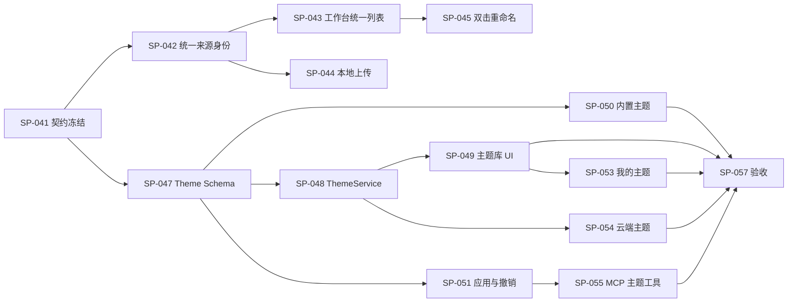

# Superior Point（SP）开发路线图 v1.1

> **文档版本**：Roadmap v1.1（规划版本，非应用 v1.1.0 发布版）
> **更新日期**：2026-10-11
> **仓库**：[J-X-C-Z/Superior-Point](https://github.com/J-X-C-Z/Superior-Point)
> **部署环境**：Hakari · <https://sp.jxcz.top>
> **状态**：需求规划稿；**未据此修改代码、仓库、数据库或线上部署**。
> **继承**：Roadmap v1.0 的服务化、权限、MCP、Admin、安全与运维要求继续有效；本版更新当前基线并新增统一项目库、Agent 指引、快捷重命名和**独立主题库**。
> **扩充说明**：本增补版同时逐项盘点未主动提出但仍未完成的编辑器、放映、录制、动画、PPTX、MCP、后台、监控、备份和多端功能；**SP-058～SP-094** 为新增实施工作包。

---

## 0. 本次升级摘要

**本版最重要的新增能力是“主题库（Theme Library）”，不等同于编辑器内添加一个颜色/主题选择按钮。** 主题库是拥有资源模型、列表、预览、应用、创建、管理、导入导出、云端归属、权限与 MCP 接口的独立产品模块。

新增需求登记：

| 编号 | 功能 | 类型 | 优先级 | 状态 |
|---|---|---|---|---|
| SP-F001 | 本地与云端项目合并到同一工作台，支持本地项目主动上传云端 | 工作台/存储 UX | P0 | 待开发 |
| SP-F002 | 在工作台增加 Agent MCP 接入指引 | 用户引导 | P1 | 待开发 |
| SP-F003 | 双击项目名称直接重命名 | 交互优化 | P1 | 待开发 |
| **SP-F004** | **独立主题库（内置/个人/云端/导入主题，预览、使用与 MCP）** | **完整功能模块** | **P1** | **待开发** |

**交付策略**：先解决 SP-F001 的统一项目工作台，再完成主题数据契约和最小主题库；主题库先做可验证的完整闭环，再逐步扩展到动画、模板、外部 Design Systems 及社区主题。不允许只做静态卡片冒充可用主题库。

---

## 1. 实际开发基线（截至 2026-10-11）

| 模块 | 已有能力或验收记录 | 仍然缺失 / 限制 |
|---|---|---|
| 服务化 | `0.1.0-alpha`、Fastify/TypeScript API、PostgreSQL、Hakari HTTPS 部署有正式验收记录 | 预发布状态；不能当作 Stable |
| 用户与 Admin | Session、Admin/User RBAC、Token、后台仪表盘/用户/项目/授权/审计/设置/备份界面 | 高级监控、MCP 调用分析仍待开发 |
| 项目服务 | 服务端 Project Service、Core 修订 CAS、租约、草稿保留与恢复、浏览器云端项目 | UI 仍要求在本地/云端库之间手动切换 |
| MCP | 本地 stdio Bridge，经 PAT/HTTPS 操作云端相同 PostgreSQL；11 个工具 | 原生远程 HTTP MCP/OAuth 尚未实现 |
| 编辑器 | 集成 v0.39；文本、形状、图片、拖动、缩放、保存/重开、HTML 可编辑与观众导出有范围内验收 | 集成全屏、录制、复杂动画、完整 PPTX 导入/保真未完成 |
| 主题 | 尚无被验收的完整主题库产品模块 | SP-F004 为本路线图新增需求 |
| 运维 | App/DB 重启及 HTTPS 验收记录 | 生产每日/离机备份和正式恢复演练明确延期；整机重启未验收 |

**证据入口**：[`README`](https://github.com/J-X-C-Z/Superior-Point/blob/main/README.md)、[`Alpha 生产验收`](https://github.com/J-X-C-Z/Superior-Point/blob/main/docs/verification/hakari/acceptance.md)、[`MCP Bridge`](https://github.com/J-X-C-Z/Superior-Point/blob/main/docs/mcp/bridge.md)、[`编辑器限制`](https://github.com/J-X-C-Z/Superior-Point/blob/main/docs/acceptance/sp016-frozen-presentation-permissions-pptx.md)。本表依赖最近已读取的仓库及验收文档，**不是在本轮新执行的生产测试**。

**版本说明**：Roadmap v1.1 是计划修订编号；应用实际发布版本依然是 `0.1.0-alpha`（按仓库最新记录）。不得把 Roadmap v1.1 写成 SP App v1.1.0 已发布。

---

## 2. 目标产品结构

```text
Superior Point / sp.jxcz.top
├── 统一工作台（所有项目一张列表）
│   ├── 本地项目（当前浏览器）
│   ├── 云端项目（当前已登录账号）
│   ├── 未同步/恢复草稿
│   ├── 上传云端 / 搜索 / 最近使用 / 回收站
│   └── 项目双击重命名 / 导入 / 导出
├── 主题库  ★ 新增核心模块
│   ├── 发现主题：内置 / 精选 / 分类 / 搜索
│   ├── 我的主题：本地 / 云端 / 收藏
│   ├── 主题详情：封面 / 正文 / 图表 / 图片 / 动画样例
│   ├── 应用与管理：新建、套用、另存、编辑、删除、导入导出
│   └── Agent 使用主题：查询、预览、应用（受权）
├── 编辑器（设计 → 主题入口，基于同一主题模型）
├── Agent 接入中心（连接教程 + PAT + 客户端配置）
├── 账号与设置
└── /admin（既有管理员后台 + 后续主题治理能力）
```

**本地与云端“合二为一”是用户体验和项目入口统一，不意味着把数据安全边界合并**。未上传的本地内容仍仅存在当前浏览器；云端内容仍由服务器认证和项目权限控制。列表使用复合项目身份 `(source, projectId[, accountId])`，防止本地与云端恰好同 ID 时误操作。

---

## 3. SP-F001｜统一项目工作台（P0）

### 3.1 用户体验

- 登录前工作台显示本地项目，登录后**原位置显示本地 + 当前账号云端项目**；移除“使用本地 / 使用云端”的互斥式业务切换。
- 项目卡片显式显示 `仅本地`、`已上传云端`、`云端`、`待恢复草稿` 等来源/同步状态，避免把本地误写为云端已保存。
- 本地项目在卡片操作中显示 **“上传云端”**；上传成功后回读核验、关联来源与云端新 ID，保留本地原件。不要自动删除或覆盖。
- 上传后可以在同一个工作台打开云端版本，未来可支持“上传后继续编辑云端版本”，但默认不得无提示切换权威对象。
- 网络断开时本地项目仍能查看和编辑；云端不可访问时页面保留本地项目并给出明确降级说明，而非整个列表失败。
- 列表可按来源筛选，但**筛选不是两个独立工作模式**；搜索、最近使用和回收站仍用同一入口。
- 对同名或同 ID 项目用来源/云端身份区分，所有打开、重命名、复制、删除、导出操作必须正确路由到所属存储。

### 3.2 实现约束

- 保留 `ProjectStore`（本地 IndexedDB）、`CloudProjectStore`（云端 API）、`CloudDraftStore`（恢复草稿），新增**UnifiedProjectLibrary** 作为聚合/分发层；不把全部云端文档复制到 IndexedDB 作为第二份权威库。
- `list/get/open` 按来源读取，`create/save/remove` 显式绑定单一对象的来源；数据库层项目所有权规则保持不变。
- 卡片操作参数应使用 `ProjectRef={source:'local'|'cloud', projectId, accountId?}`，而非只传字符串 ID。
- 只有登录后才能上传云端；上传使用现有导入 API + 幂等请求 + 内容回读，复用现有迁移逻辑。
- 保存失败、登出、会话过期、跨用户切换、写入权失效、未确认编辑器快照时不得抛弃恢复草稿。
- 保持旧 IndexedDB schema 和现有本地数据可读取；迁移不依赖手动导出。

### 3.3 验收

- [ ] 同一登录工作台同时显示原本地项目与该账号云端项目。
- [ ] 上传本地项目成功：新云端 ID、内容/页面/备注/扩展字段回读一致，本地原件未改。
- [ ] 断网进入列表：本地项目仍能操作，云端显示不可用状态而不是消失成零项目。
- [ ] 两个来源相同 ID/标题不发生误编辑、误删、误恢复。
- [ ] 跨账号登出/登录，另一用户的云端数据及草稿不泄露；本地原项目仍保留。
- [ ] 原单写者租约、CAS、防盲写、Agent 接力的测试全部继续通过。

---

## 4. SP-F002｜Agent 接入指引（P1）

### 4.1 入口与内容

- 工作台侧栏增设 **「接入 Agent」** 或靠近账号区域的**明确入口**；不要把完整教程挤进 344px 头像下拉框。
- 独立详情页或可访问的大尺寸侧面板：**① 创建令牌 → ② 安装/获取 Bridge → ③ 客户端配置 → ④ 测试连接 → ⑤ 使用与撤销**。
- 针对 Codex、Claude Code、通用支持 stdio MCP 的客户端提供客户端专属指导；显示 OS 适用说明和客户端差异。
- 显示当前已经实现的 `stdio Bridge + HTTPS PAT` 方案，不得把尚未开发的 `/mcp`、OAuth 当成现成服务。
- 提供安全的**不含真实 Token** 的可复制配置示例；用户自己把 PAT 安全注入环境，不将其放在项目文件或公开示例中。
- 说明 `projects:read/create/write/export/delete` 的最小权限原则，并默认不建议授予删除权限。
- 提供 `sp_list_projects` / `sp_get_document` 只读连接验证步骤，以及操作异常诊断（401、403、409、超时）。
- 令牌只能在创建当次显示；之后只允许查看前缀与元数据并撤销。

### 4.2 验收

- [ ] 用户从工作台最多 2 次点击打开 Agent 指引。
- [ ] 按指引可完成至少一个真实 stdio MCP 客户端的连接/工具调用（测试账号、测试项目）。
- [ ] 没有客户端环境时页面明确说明需本地运行 Bridge，不会诱导用户把 Token 贴到网页公开区域。
- [ ] 手机窄屏可阅读，代码段支持横向查看与复制；无真实密钥写进日志。

---

## 5. SP-F003｜双击项目名称重命名（P1）

- 双击项目卡片标题进入原位可编辑输入框，聚焦并选中旧名称；单击卡片封面仍用于打开编辑。
- `Enter` 提交，`Escape` 取消，失焦提交；空白/过长名称拒绝并恢复可操作状态。
- 保存期间显示忙碌状态；出现本地锁、云端租约、CAS 冲突或网络失败时保留原值并提示，不误报成功。
- 成功更新当前卡片、项目列表及最近使用标题；键盘用户保留原「重命名」按钮。
- 使用 UnifiedProjectLibrary 按 `ProjectRef` 路由；双击不能触发打开项目。

**验收**：本地/云端各跑 Enter、Escape、失焦、空名称、保存失败、多标签冲突，编辑后刷新仍正确。

---

# 6. SP-F004｜独立主题库（Theme Library）——核心新增

## 6.1 定位与边界

**主题（Theme）**：约束整份演示文稿的颜色、字体、布局规则、背景、组件样式和可选动效倾向的**可复用设计系统资源**，不是完整演示文稿模板，也不是某一张幻灯片截图。

**模板（Template）**：具有特定页面结构、占位符和示例内容的可复制演示文稿；可以引用某个主题，但必须区分 `themeId` 与 `templateId`。

**主题库（Library）**：可以检索、浏览、预览、版本管理、收藏、导入/导出、授权与应用主题的产品模块。首版必须形成 “库 → 主题详情 → 预览 → 应用 → 保存/重开/导出” 的闭环。

### 非目标（首版不做）

- 不要求立刻建立可公开投稿的社区市场、交易、评分或审核社区。
- 不通过简单 CSS 替换覆盖用户每个对象的手工设置。
- 不承诺把所有 Design Systems 资源库直接自动转换为高保真 PPT 主题。
- 不承诺 PPTX/Reveal.js 中尚未支持的动画、母版、字体效果 100% 一致。

## 6.2 用户界面与信息架构

**导航**：工作台左侧新增 `主题库`，不挤占「工作台／最近使用／我的幻灯片／回收站」之间的信息层级。编辑器「设计」选项卡新增 `浏览主题库`、`当前主题`、`应用主题`。

```text
主题库
├── 发现主题
│   ├── 全部 / 精选 / 最近使用
│   ├── 分类、风格、颜色、比例、适用场景筛选
│   └── 卡片：封面预览、名称、作者、主题标签
├── 我的主题
│   ├── 本地主题（当前设备）
│   ├── 云端主题（账号）
│   ├── 收藏主题
│   └── 创建 / 编辑 / 导入 / 导出
└── 主题详情
    ├── 概述 / 来源 / 许可证 / 版本
    ├── 多种实际内容样例预览
    ├── 颜色与排版规范
    ├── 支持的画布比例与能力限制
    └── 使用主题新建 / 应用到已有项目 / 另存我的主题
```

**主题卡片预览最低要求**：不能只展示一张色块封面；至少包含标题页、文字内容页、数据/图表页、图片/组合元素页这四类典型幻灯片（首批主题可用共用测试内容渲染），并能选择 16:9 与 4:3 测试或明确标注支持范围。

## 6.3 主题数据模型（建议 v1）

建议定义可版本化 JSON schema；样例只用于说明结构，不代表最终字段已在 Core 实现：

```json
{
  "schemaVersion": 1,
  "id": "theme-noema-base",
  "name": "Noema Base",
  "version": "1.0.0",
  "author": "SP",
  "license": "internal",
  "tags": ["editorial", "minimal"],
  "supportedRatios": ["16:9", "4:3"],
  "tokens": {
    "colors": {"background": "#F6F5F0", "text": "#252525", "accent": "#606760"},
    "typography": {
      "title": {"fontFamily": "sans-serif", "fontSize": 52, "fontWeight": 700},
      "body": {"fontFamily": "sans-serif", "fontSize": 24, "lineHeight": 1.35}
    },
    "spacing": {"unit": 8, "pageInset": 64},
    "components": {"title": "title-default", "caption": "caption-muted"},
    "motion": {"durationMs": 450, "easing": "ease-out"}
  },
  "layouts": [{"id": "cover"}, {"id": "content"}, {"id": "data"}],
  "assets": [],
  "preview": {"slides": ["cover", "content", "data", "image"]}
}
```

**关键设计约束**：

1. 主题以 token 与布局规则为核心，避免以绝对坐标快照代替设计语言。
2. 文档保存 `themeRef={id,version}`，并允许嵌入不可变的主题快照/发布哈希，避免主题作者升级后老项目悄悄变样。
3. 对象级样式、页面级覆盖与主题默认值应有确定的优先关系：`手动对象覆盖 > 页面覆盖 > 主题布局/组件 > 主题全局 token > SP 默认值`。
4. 主题更新不得默默重排用户已编辑的元素；应用前预览差异，应用后保留撤销/恢复路径。
5. 资产使用可验证哈希与安全格式；不允许主题包执行脚本、任意外网加载或突破编辑器 iframe 隔离。
6. 字体应提供后备字体与许可信息；未授权字体不得自动打包或上传。
7. 记录 schema 版本和显式迁移器；未来扩充 motion/layout 时不可丢弃未知安全字段。

## 6.4 本地主题和云端主题

- 内置主题：随版本发布，只读，允许用户“另存为我的主题”再修改。
- 本地主题：保存在用户浏览器的专用 IndexedDB 存储中；未登录可使用，明确标记为仅当前设备可用。
- 云端主题：归属于用户账号，由后端鉴权存储；用户可主动把本地主题上传云端，回读后保留原件。
- 收藏/最近使用：对于内置或云端主题记录轻量引用，不需复制整个包。
- 对“同一主题的本地与云端版本”显式关联来源、版本和哈希，禁止按标题自动覆盖。
- 多租户隔离：普通用户无法读取其他用户的私人主题，管理员默认只查看管理元数据，不自动访问私人主题的完整配置/资产。

## 6.5 应用主题（最高风险交互）

- 可以通过主题库新建演示文稿，生成与主题相匹配的初始页面。
- 对已有项目应用前展示预览与预计变更范围（颜色、字体、布局、背景、动画）；避免让用户以为所有对象都会完美重排。
- **默认模式：仅替换主题驱动的样式，保留手工覆盖、内容、图片、备注、动画数据。** 另提供可明确选择的「重置为主题样式」模式，需先确认。
- 主题应用通过 Document Core 单次原子操作（或可审计批次）提交，带预期修订号；冲突使用现有 CAS 和租约错误处理。
- 一次应用可撤销；历史版本/备份能恢复原样；失败时没有半应用状态。
- 仅将实际受支持的效果输出到 Reveal.js/HTML/PPTX；不受支持时提示降级及其具体变化，不能假装预览等于最终播放。

## 6.6 主题编辑器（首版范围控制）

第一轮提供“从主题复制 → 修改颜色/字体/背景/布局参数 → 实时样例预览 → 保存到我的主题”，不必一次性实现完整可视化设计系统编排器。

- 基础编辑：颜色、字号、字体、文字层级、基础页边距、背景、圆角/边框等受支持 token。
- 布局：至少 Cover / Section / Content / Data 四类规则，支持常用画布比例。
- 预览：使用和实际编辑器一致的渲染逻辑，保留真实数据检查（图表、图片、表格等）。
- 导入导出：`.json` 或安全打包格式，校验 schema、版本、资源大小与许可证；不把主题包等同于任意 HTML 代码。
- 支持主题复制、重命名、归档、删除；删除被文档引用的主题时要保留文档内固定快照或给出清晰迁移提示。

## 6.7 内置主题起步包

主题数量宁可少而完整：建议首版有 **4–6 套差异明显且经过样例验收的主题**，而不是 20 套仅换颜色的主题。可从个人 Design Systems 资源库中选取适合演示文稿的方向，示例候选：

| 候选方向 | 需要验证的独特性 |
|---|---|
| Noema | 克制编辑布局、结构层级、留白与信息密度 |
| 瑞士信息设计 | 网格、对齐、字号层级、几何秩序 |
| 编辑杂志 | 图文节奏、标题层级、跨页叙事 |
| 精密工业 | 数值/标注、细线、规格型组件 |
| 温暖插画 | 叙事性插画占位、柔和排版、适度颗粒/纹理策略 |
| Y2K 复古未来 | 层次、强调色、几何与动效规则 |

以上是候选，不代表已经授权、迁移或存在 SP 内置主题；具体名称应按 Design Systems 仓库的真实定义核对。Lumina 与 MiMo 等设计语言要保留各自辨识度，**不能简单混合成同一主题**。

## 6.8 主题库后端与 MCP API（建议接口）

建议新增表：

| 表 | 用途 |
|---|---|
| `themes` | 主题 ID、拥有者、可见性、当前版本、状态、来源 |
| `theme_versions` | 不可变 JSON schema、哈希、版本号、发布时间 |
| `theme_assets` | 字体之外的授权主题资源及内容哈希 |
| `theme_favorites` | 用户收藏关系 |
| `theme_usage`（后期可选） | 应用行为统计，不收集演示文稿正文 |

建议 API（以 `/api/v1` 为前缀；**尚未实现**）：

```text
GET    /themes                         列表、分类、搜索
GET    /themes/{id}                    详情
GET    /themes/{id}/versions/{version} 固定版本
POST   /themes                         创建私人主题
POST   /themes/import                  安全导入主题
PATCH  /themes/{id}                    更新草稿/元数据
POST   /themes/{id}/publish            发布不可变版本
POST   /themes/{id}/favorite           收藏
DELETE /themes/{id}/favorite           取消收藏
POST   /projects/{projectId}/theme     预期修订 + 应用模式 + 幂等键
GET    /projects/{projectId}/theme     当前主题与锁定版本
```

MCP 工具（在远程网关与本地 Bridge 共用同一授权业务服务，**待实现**）：

- `sp_list_themes`：列出当前用户有权访问的主题。
- `sp_get_theme`：返回指定主题的 token、兼容声明和版本。
- `sp_preview_theme`：基于安全演示数据输出预览或结构化兼容报告。
- `sp_apply_theme`：需项目写入权限，按 CAS 原子应用指定主题版本。
- `sp_save_theme`：创建/保存用户私人主题；需独立主题写权限。

推荐明确独立 Scope：`themes:read`、`themes:write`、`themes:publish`，并限制 `sp_apply_theme` 同时拥有 `projects:write` 和 `themes:read`。所有查询与写入都由服务器验证归属、版本和配额，不允许 Agent 提交可执行主题代码。

## 6.9 主题库测试矩阵

| 分类 | 必须覆盖 |
|---|---|
| 语义 | 同一主题 16:9/4:3、四种样例页、颜色对比与排版层级 |
| 资源 | 缺失字体、缺图、超大资源、恶意 JSON、活动脚本、未知版本 |
| 数据 | 保存/刷新/新设备回读、本地上传、离线缓存、主题版本固定 |
| 兼容 | 浏览器预览、编辑器展示、Reveal HTML、已支持的 PPTX 子集 |
| 不破坏 | 文字、图片、备注、手工样式覆盖、组合、动画数据保留 |
| 权限 | 跨用户查询/修改拒绝、Token Scope、被吊销访问、越权分享 |
| 并发 | 同一文档已有编辑、Agent 旧 revision、重复请求、失败恢复 |
| 易用性 | 搜索、过滤、卡片/详情、键盘导航、320px/390px 移动视口 |

### 主题库 MVP 完成定义（Definition of Done）

- [ ] 页面入口可从用户工作台与编辑器设计选项卡进入。
- [ ] 至少 4 套真正不同且有实际预览的内置主题可浏览、搜索、筛选。
- [ ] 主题详情能预览标题、内容、数据、图片四类页面及基础样式规则。
- [ ] 可用主题新建文稿，给既有项目应用主题并撤销；内容不丢失。
- [ ] 自定义主题可编辑、保存、重开、导入/导出。
- [ ] 登录后可把自己的本地主题主动上传云端；来源与版本清晰。
- [ ] SP 客户端通过至少一个真实 MCP 工具读取并应用主题，服务端权限与 CAS 验证通过。
- [ ] 安全/版本/回读/冲突测试和真实浏览器核心流程通过。
- [ ] 主题许可证、预览限制及不支持的导出效果有明确提示。

---

## 7. 后端、管理后台和运维衔接

### 后端

- 主题库与文档核心解耦：`ThemeService` 负责资源/版本/权限；`ProjectService` 负责文档原子写入；主题操作不得直接在 API 路由中修改文档 JSON。
- PostgreSQL 保持项目正文唯一云端权威，主题资源也采用版本化存储；静态主题资产放在受控路径/资产服务。
- 数据迁移可向前兼容，不强制改写所有现有文稿；老项目无主题引用时使用默认视觉约定。

### Admin 后台（新增主题管理能力）

- 内置主题上/下架、元数据检查、版本、体积、兼容性状态。
- 主题使用统计为聚合指标；默认不读取私人主题正文与用户幻灯片正文。
- 如以后开放共享/社区主题，增加审核、许可证、举报与撤销机制；这不属于当前 P1 MVP。

### Hakari 上线要求

- 使用独立开发分支/PR，完成迁移与回归后再部署；**不在本规划阶段修改线上**。
- 小内存主机避免每次打开列表都为全部主题渲染四张高分辨率缩略图；采用静态缩略图、按需加载、缓存与限制尺寸。
- 主题包校验大小、哈希与权限，防止恶意资源导致服务内存或磁盘耗尽。
- 生产备份当前仍处于延期状态；任何涉及新增持久化主题数据的正式上线前，需重新确认备份与回滚风险。

---

## 8. 版本阶段与开发工作包

### M0：基线复核与接口冻结（1 个工作包）

| ID | 工作 | 优先级 | 依赖 | 验收 |
|---|---|---|---|---|
| SP-041 | v0.1 Alpha 基线冻结，项目引用模型、主题 schema 和扩展迁移契约 | P0 | 已有 v0.1 | API/schema 文档 + 不变量 + 测试计划通过评审 |

### M1：统一工作台与基础易用性

| ID | 工作 | 优先级 | 依赖 | 验收 |
|---|---|---|---|---|
| SP-042 | UnifiedProjectLibrary 聚合层与来源身份 | P0 | SP-041 | 同 ID 来源互不干扰 |
| SP-043 | 项目卡片统一列表与来源状态 | P0 | SP-042 | 登录前后均能看到本地；登录后也看到云端 |
| SP-044 | 本地项目上传云端 + 回读/幂等/映射 | P0 | SP-042 | 上传成功不修改原件；断网不误报 |
| SP-045 | 双击名称原位重命名 | P1 | SP-043 | 本地/云端完整键盘与失败验收 |
| SP-046 | Agent 接入指引与配置样例 | P1 | 既有 PAT/Bridge | 实际客户端端到端连接一次 |

### M2：主题库 MVP（本版重点）

| ID | 工作 | 优先级 | 依赖 | 验收 |
|---|---|---|---|---|
| SP-047 | Theme schema、token 级联规则与版本锁定 | P0 | SP-041 | Schema 校验、升级兼容、引用快照测试 |
| SP-048 | ThemeService、存储、ACL、主题资产安全 | P0 | SP-047 | 跨用户拒绝、资源校验与迁移通过 |
| SP-049 | 主题库列表、分类、搜索、主题卡片与详情 | P1 | SP-047 | 至少四类样例页可预览 |
| SP-050 | 四至六套有辨识度的内置主题 | P1 | SP-047 | 多场景 + 不同比例差异化验收 |
| SP-051 | 文档应用主题、继承/覆盖、撤销与 CAS | P0 | SP-047、现有 Core | 原子提交，手工内容无损 |
| SP-052 | 从主题新建演示文稿与编辑器设计入口 | P1 | SP-049、SP-051 | 新建、编辑、重开一致 |
| SP-053 | 我的主题：复制、自定义、导入导出、删除 | P1 | SP-048、SP-049 | 保存/重开/版本安全测试 |
| SP-054 | 个人主题云端化与本地主题上传 | P1 | SP-043、SP-048 | 本地原件保留、云端回读一致 |
| SP-055 | MCP 主题工具与授权 Scope | P1 | SP-048、SP-051 | Agent 可查询/应用，无越权 |
| SP-056 | 主题兼容报告与 Reveal/HTML/PPTX 子集验收 | P1 | SP-050～055 | 实际渲染差异与降级说明 |
| SP-057 | 主题库端到端、安全、性能与无损回归 | P0 | SP-049～056 | 全部 MVP DoD 通过 |

### M3：延续 Roadmap v1.0 中未交付的能力

| 工作流 | 保留目标 | 计划阶段 |
|---|---|---|
| 远程 MCP / OAuth | Streamable HTTP MCP、用户授权 | v0.2.x |
| 云端变更通知 | SSE、浏览器安全刷新 | v0.2.x |
| 版本历史 | 查看、对比、恢复文档修订 | v0.2.x |
| Admin 深化 | Hakari 资源监控、MCP 调用统计与异常分析 | v0.2.x |
| PowerPoint 兼容 | PPTX 导入导出、母版、图表、复杂动画 | v0.3.x+ |
| 高级 AI 编辑 | AI 修改差异、预览、接受/恢复 | v0.3.x+ |
| 生产稳态 | 正式备份/恢复、容量/故障/整机重启演练 | Stable 发布前必须复核 |

**推荐交付版本**：`v0.1.x` 修工作台 P0；`v0.2.0 Beta` 交付统一项目库、Agent 指引与主题库基础可用版；`v0.2.x` 将主题库 MVP（含个人主题、MCP、兼容报告）补齐并验收；`v0.3.x` 扩展主题动画、模板生态与跨软件保真。版本可按实际拆分，但主题库 MVP 任何不完整项必须显式标注。

---

## 8.1 未被单独提出、但尚未交付的功能缺口（增补）

> 本节是 **2026-10-11 基于仓库 README、源文件与既有验收记录的缺口盘点**，不是新跑的生产测试。状态只使用「已有且验收范围有限」「未接入」「未实现」「待生产验收」「规划增强」等可验证描述；不将“有按钮/有源码”视为可用。

| 功能域 | 已有依据 | 未完成的具体内容 | 优先级 | 判定 |
|---|---|---|---|---|
| 浏览器编辑器稳定性 | Chrome/Firefox 主路径已验证；v0.39 iframe 适配存在 | 全屏权限、媒体权限、剪贴板与复杂交互的跨引擎回归；异常草稿恢复的真实场景 | P0/P1 | 部分完成 |
| 放映 | 窗口放映、离线 Reveal HTML 子集已通过 | 集成全屏、演讲者视图、备注/计时器、双屏、演示者控制的明确产品化 | P1 | 全屏未通过，其余按需新增 |
| 录制 | 录制入口/工作室 UI 存在 | iframe 摄像头/麦克风授权、实际录制、文件完整性、权限拒绝提示；原生动画/媒体支持范围定义 | P1 | 实际录制未通过 |
| 动画与转场 | 已有基础淡入、淡出和效果目录 | 脉冲等强调效果、同对象多动画组合、触发顺序、时间线编辑、导出/放映一致性及浏览器实测 | P1 | 部分通过、部分未验收 |
| PPTX 导入 | 冻结源编辑器可尝试部分子集 | **正式工作台尚未接入 PPTX 导入**；表格/图表/SmartArt/母版/动画恢复 | P1 | 未接入 |
| PPTX 导出 | ZIP/XML 的文字、形状、PNG、表格和图表结构子集通过 | 在真正的 PowerPoint/LibreOffice 中复核可打开性、布局、字体、图表、动画、母版；提供兼容性报告 | P1 | 结构通过、视觉保真未认证 |
| 其他导出 | 现有 editable HTML、audience HTML、JSON | PDF/PNG/SVG 等可选导出及服务端渲染能力需要单独立项，不能把现有静态 SVG 文本当 PNG 引擎 | P2 | 未纳入当前发布保证 |
| 素材 | 当前文档以嵌入图片为主要权威载体 | 个人素材库、资源去重、图片压缩、缩略图、缓存与清理、外链处理规则 | P2 | 未实现完整资产库 |
| 主题库 | SP-F004 已有详细路线 | 主题性能预算、多版本迁移、字体许可证、可访问性与导出降级 | P1 | 新增未实现 |
| 版式与母版 | 核心有基础元素与画布 | 幻灯片母版、布局占位符、统一页脚/编号、对象排列对齐、高级组合及跨页复用 | P2 | 非现有成熟能力 |
| 文档历史 | Core 内存撤销与修订号/持久性基础存在 | **用户可浏览的历史版本、差异、恢复和 AI 操作回滚**；不能将 revision 号等同于完整历史 UI | P1 | 未完整交付 |
| 人机协作 | 单写者租约与“交给 AI/取回编辑”已通过 | SSE 修订通知、自动安全更新、AI 修改差异审核；多人同时改同对象为远期项目 | P1/P2 | 接力已完成，实时协作未实现 |
| MCP 连接 | PAT + stdio Bridge、11 工具已通过 | Streamable HTTP MCP、OAuth、发现元数据、兼容矩阵；远程 Agent 无需本地 Bridge | P1 | 未实现 |
| MCP 工具丰富度 | 创建/读取/编辑/验证/预览/导出基本闭环 | 资源读写、版本对比、主题工具、成批排版检查、错误诊断；遵守最小授权 | P1/P2 | 待扩展 |
| 用户体验 | 账号、项目与本地迁移已实现 | 统一列表、离线状态、恢复中心、全局搜索与筛选、操作反馈、键盘操作与可访问性 | P0/P1 | SP-F001 后续延伸 |
| 管理后台 | 用户、项目、Token、审计、设置、备份页面存在 | 真正的 Hakari 资源监控、MCP 工具调用统计、时间范围筛选/分页、全局搜索、配额策略 | P1 | 基础可用，深度不足 |
| 身份安全 | 密码 Session、RBAC、PAT、CSRF 与限流已有 | 管理员双因素、异常登录提醒、会话/设备中心、权限策略细化；安全测试回归 | P1/P2 | 基础已完成、增强未完成 |
| 共享与协作 | 私有 owner 项目模型 | Project ACL（Owner/Editor/Viewer）、定向共享、只读链接与过期、撤销访问；需与观众 HTML 分享区分 | P2 | 未实现 |
| 多端适配 | 390px 账号弹层有实测 | 完整移动/平板阅读和项目管理、触控操作、横竖屏适配；移动完整编辑可在后期评估 | P2 | 局部验收 |
| 性能与容量 | Hakari 低负载记录 | 大文档图片占用、长列表性能、100+ 页压力、并发连接与内存限制、弱网退避/重试 | P0/P1 | 未完成容量验收 |
| 运维保障 | Docker/HTTPS/容器重启有证据，备份 CLI 与后台存在 | 生产每日备份、离机备份、恢复演练仍**按用户历史决定延期**；整机重启未演练；告警未闭环 | P0（启用前确认授权） | 生产未完成 |
| 发布工程 | Node22 CI 服务测试与常规测试有历史通过记录 | 版本化发布清单、升级数据库兼容矩阵、生产烟测、回滚演练、依赖安全更新策略 | P1 | 持续维护 |
| 产品化文档 | README、服务指南、Bridge 文档已有 | 版本化 API/用户说明、错误恢复教程、主题创作指南、客户端连接教程、变更记录和已知限制清单 | P1 | 继续完善 |

### 明确的历史失败和“不能误报”的项目

- **全屏**：`Permissions policy violation: fullscreen is not allowed in this document`；当前仅窗口放映通过。
- **录制**：麦克风/摄像头权限实际未通过；录制 UI 存在不等于功能已实现。
- **强调动画**：同对象脉冲运动未被认证；动画字段留存不等于播放正确。
- **PPTX**：工作台拒绝 PPTX 导入；导出仅验证 ZIP/XML 子集，未证明原生 PowerPoint 视觉保真。
- **MCP**：本地 stdio Bridge ≠ 公网 `/mcp`；当前无远程 HTTP/OAuth 能力。
- **备份**：生产定时/离机备份与恢复演练延期；测试环境 `pg_dump/pg_restore` 通过不能代替生产数据保障。
- **重启**：App/DB 容器重启通过 ≠ Hakari 整机开机恢复已通过。

## 8.2 补充可执行工作包（SP-058～SP-094）

> 与 SP-041～057 **并列纳入待办**；其中 P0 表示阻断所对应正式承诺的发布能力，不代表未经授权就可启用备份或重启生产主机。

| 编号 | 任务 | 优先级 | 依赖 | 可验收交付 |
|---|---|---|---|---|
| SP-058 | 集成全屏放映权限修复 | P1 | iframe 权限威胁模型 | Chrome/Firefox 真正全屏成功、Escape 退出；无越界权限扩大 |
| SP-059 | 演讲者视图与备注/计时器 | P2 | SP-058 | 演讲端/观众端分离，备注不出现在观众导出 |
| SP-060 | 录制工作室权限及可靠导出 | P1 | iframe 安全审核 | 允许/拒绝权限与真实音视频录制场景通过，输出可重播 |
| SP-061 | 动画与转场兼容矩阵 | P1 | 既有动画库 | 按效果/触发/顺序/输出格式记录实测 Pass/Fail/Unknown |
| SP-062 | 强调效果、脉冲与组合动画修复 | P1 | SP-061 | 同对象多段效果与离线 HTML 真正播放通过 |
| SP-063 | 动画时间线与高级触发编辑 | P2 | SP-061 | 可视化编辑 delay/duration/order、撤销/导出一致 |
| SP-064 | 编辑器对象操作补齐 | P1 | v0.39 Core adapter | 选中/多选/排列/对齐/分布/组操作在真实鼠标和键盘下稳定 |
| SP-065 | 编辑器权限/剪贴板跨浏览器验收 | P1 | 适配器安全边界 | 浏览器内/系统剪贴板明确权限，未获权时可恢复且无静默失败 |
| SP-066 | 工作台 PPTX 导入 MVP | P1 | 解析边界与大小限制 | 至少文字、图片、基础形状导入；不支持项结构化报错而非丢弃 |
| SP-067 | PPTX 双向保真测试集 | P1 | SP-066/既有导出 | 原生 PowerPoint/LibreOffice 对比截图与 round-trip 差异报告 |
| SP-068 | PPTX 高级对象支持 | P2 | SP-067 | 表格、图表、SmartArt、母版和动画分别清楚定义支持级别 |
| SP-069 | PDF/图片批量导出能力评估与实现 | P2 | 放映渲染稳定 | 先冻结产品范围，再提供可重复导出、错误诊断与资源上限 |
| SP-070 | 个人素材库及图片资源管理 | P2 | Cloud Assets/主题资产安全 | 上传、检索、去重、回收与文档引用保持有效 |
| SP-071 | 高级排版与对象样式工具 | P2 | SP-064、Theme Tokens | 网格/智能参考线/统一文字样式/对象样式真实可编辑 |
| SP-072 | 幻灯片母版与布局模板 | P2 | SP-047、SP-071 | 版式继承、占位符、局部覆盖、保存/导出/撤销闭环 |
| SP-073 | 历史版本列表、差异与恢复 | P1 | ProjectService 修订设计 | 修订元数据可读，恢复生成新修订且不覆盖他人新写入 |
| SP-074 | SSE 修订变更通知 | P1 | CAS 与权限 | Agent 修改后自动提示，断线可重连，不自动覆盖草稿 |
| SP-075 | AI 修改差异面板与审核 | P2 | SP-073～074 | 可定位被修改的幻灯片与对象，撤销或恢复动作有审计 |
| SP-076 | 远程 Streamable HTTP MCP | P1 | 现有 Bridge 契约 | `/mcp` 兼容主要客户端，所有工具仍受项目权限检查 |
| SP-077 | MCP OAuth 2.1 授权接入 | P1 | SP-076 | 发现、授权码/PKCE、撤销、Scope 和客户端兼容测试 |
| SP-078 | MCP 工具与结构化诊断扩展 | P1 | SP-076、SP-073、SP-055 | 版本、资源、主题、兼容性工具各具真实端到端用例 |
| SP-079 | Agent 连接状态/调用分析 | P1 | 审计事件与可观察性 | 管理后台提供按工具/用户/时间范围的次数、耗时和错误率 |
| SP-080 | Hakari 系统监控仪表盘 | P1 | 合法最小权限监控采集 | CPU/内存/磁盘/容器/API/DB，指标异常不暴露敏感配置 |
| SP-081 | Admin 全局检索、筛选与分页增强 | P1 | Admin API | 后端分页筛选；跨页搜索；项目归属转移可选用户而非手填 UUID |
| SP-082 | 存储配额与资源使用治理 | P1 | Users/Projects/Assets | 每用户项目数/容量、限额提示、软限制与超限失败说明 |
| SP-083 | 安全能力增强 | P1 | 现有 Auth/RBAC | 管理员二次验证、活跃会话中心、异常登录告警与回归测试 |
| SP-084 | 项目 ACL 与协作权限评估 | P2 | SP-073、权限模型 | Viewer/Editor/Owner 授权不依赖平台 Admin 身份 |
| SP-085 | 安全分享链接与访问撤销 | P2 | SP-084 | 过期/只读/撤销/访问审计；明确区别完整 editable HTML |
| SP-086 | 移动端、平板端完整阅读与管理 | P2 | SP-043、SP-049 | 320px/390px/平板真实触控，无内容溢出与不可达操作 |
| SP-087 | 页面/项目搜索、筛选与大库性能 | P1 | 统一列表 | 本地+云端筛选统一，长列表虚拟化/分页，弱网降级明确 |
| SP-088 | 弱网、离线及草稿恢复中心 | P0 | SP-042～044、现有草稿 | 断网编辑、重连、冲突、跨账号切换均无丢失且能选择恢复 |
| SP-089 | 大型 PPT 性能与资源上限 | P1 | SP-061、SP-070 | 约定测量样本、内存/CPU/耗时指标，超限可解释降级 |
| SP-090 | 生产备份启用决策与演练 | P0（生产） | 用户明确授权、独立存储 | 执行定时/离机加密备份和恢复验证；未获授权保持延期 |
| SP-091 | Hakari 整机启动恢复演练 | P1（生产） | 维护窗口和备份保障 | 维护窗口验证服务自动恢复，不影响既有业务及其他服务 |
| SP-092 | 安全/性能告警闭环 | P1 | SP-079～080、SP-090 | 关键失败告警可触达、可定位、有处理和关闭记录 |
| SP-093 | 发布、升级、迁移及回滚标准化 | P1 | CI、版本化迁移 | 生产烟测、回滚、数据兼容、依赖扫描与发布记录 |
| SP-094 | 用户帮助中心与开发者文档 | P1 | SP-046、主题库、MCP | 指南、限制、API 示例、问题排查和版本兼容持续更新 |

## 8.3 优先级重排与版本交付建议

| 阶段 | 必须完成的工作 | 同期可并行 | 里程碑判定 |
|---|---|---|---|
| **M1 · Alpha 体验收尾** | SP-042～044、SP-088、SP-041 | SP-045～046、SP-058、SP-064～065、SP-081 | 统一工作台无模式切换，安全上传，核心编辑/恢复没有回归 |
| **M2 · 主题库 MVP** | SP-047～057 | SP-061～062、SP-073、SP-087 | 真实主题闭环，不仅展示卡片；导出与编辑结果受验收约束 |
| **M3 · v0.2 Beta 服务增强** | SP-074、SP-076～080、SP-083、SP-093 | SP-059～060、SP-066～067、SP-082、SP-094 | 远程 Agent 接入安全可用、历史恢复可信、后台可运营 |
| **M4 · v0.3 编辑器成熟** | SP-063、SP-068～072、SP-075、SP-089 | SP-084～086 | PPTX/复杂动画按兼容矩阵逐项达标，而非 UI 占位 |
| **M5 · Stable 守门** | SP-090～092 + 已承诺功能全量回归 | 交互精修、易用性与文档完善 | 未完成备份/恢复或整机验收时保留发布阻断，不声称 Stable |

**P0 的数据安全事项不可因赶功能发布而降级。** 主题库和编辑器增强允许分批上线，但每一项被公开宣传为“支持”的能力，都应附有实际浏览器或真实客户端的验收证据。性能数字在未实测前只可写目标，不可写成已达到。

## 8.4 按功能域的 Definition of Done（补充）

1. **编辑器与动画**：具备真实用户交互路径测试（不仅 DOM/JSDOM）；目标效果在 Chrome/Firefox 中可播放；保存、重开、完整 HTML 和观众 HTML 的兼容与降级明确；不能丢失未知字段。
2. **PPTX**：至少经过一套正式 PowerPoint 客户端的导入/导出视觉验收；不支持对象返回诊断；不把 OOXML 结构检查等同可视保真。
3. **远程 MCP**：OAuth、PAT/Bridge 各自的认证模型清楚；跨用户/项目越权、令牌撤销、修订冲突、超时重试、安全路径逐一验收。
4. **Admin**：数据必须来自真实 API/监控采集；分页筛选是服务端查询；无明文密钥或文稿正文；重要操作二次验证并审计。
5. **运维与恢复**：生产备份与演练须另行取得授权；恢复校验包含 PostgreSQL 与资产，无法验证时保持红线未通过；不能只凭容器重新启动声明灾难恢复成功。
6. **产品可访问性**：键盘可完成主流程，焦点、读屏标签、减少动画偏好和触控目标符合基本可用要求；从 320px 到桌面无需横向溢出主页面。
7. **验收证据**：每个任务有变更文件、测试命令/结果、真实设备/浏览器版本、缺口、回滚说明；先 PR/CI 再安排 Hakari 变更。

### 基线证据与链接（便于复核）

- [当前 README 与 Alpha 限制](https://github.com/J-X-C-Z/Superior-Point/blob/main/README.md)
- [真实 Hakari Alpha 验收：HTTP、MCP、容器重启、备份延期](https://github.com/J-X-C-Z/Superior-Point/blob/main/docs/verification/hakari/acceptance.md)
- [SP-016 Chrome / Firefox 编辑主路径](https://github.com/J-X-C-Z/Superior-Point/blob/main/docs/acceptance/sp016-frozen-browser-mainpaths.md)
- [SP-016 全屏、录制、PPTX、复杂动画验收缺口](https://github.com/J-X-C-Z/Superior-Point/blob/main/docs/acceptance/sp016-frozen-presentation-permissions-pptx.md)
- [云端 stdio Bridge 当前工具与权限](https://github.com/J-X-C-Z/Superior-Point/blob/main/docs/mcp/bridge.md)
- [管理后台现有前端](https://github.com/J-X-C-Z/Superior-Point/blob/main/web/admin/app.js)
- [账户与云端项目 UI](https://github.com/J-X-C-Z/Superior-Point/blob/main/web/cloud-workspace.js)

---

## 9. 开发依赖与并行团队



**分工建议**：

| 小组 | 负责 | 与其他组的契约 |
|---|---|---|
| 工作台组 | SP-042～045 | ProjectRef、无损迁移和编辑器会话边界 |
| Agent 文档组 | SP-046、SP-055 配置验收 | 最小 Token Scope、真实 Bridge 协议 |
| 主题核心组 | SP-047、048、051 | Schema、主题版本、Core 原子操作 |
| 主题设计/UI 组 | SP-049、050、052、053 | 主题 token、渲染与真实样例 |
| 云端/安全组 | SP-054、055、Admin 主题治理 | ACL、跨账号隔离、资源完整性 |
| 测试/运维组 | SP-056、057 | 浏览器真实回归与发布安全门槛 |

**并行约束**：主题核心组先锁定 schema；UI 可以在真实契约定义后并行，不得反过来根据静态展示图随意创造数据模型。统一工作台和主题库可以并行开发，但共享项目引用与上传语义必须统一。

---

## 10. 统一验收总表

- [ ] **数据安全**：本地原件、云端文稿、账号草稿、主题资源均无静默覆盖；任何失败可恢复。
- [ ] **统一入口**：不再需要切换“本地/云端模式”才能查看项目；卡片来源明确。
- [ ] **上传云端**：账号权限、幂等性、来源映射及回读通过。
- [ ] **重命名**：双击、Enter/Escape、失焦、并发冲突通过。
- [ ] **Agent 指引**：从工作台可见、按当前真实协议操作、Token 安全。
- [ ] **主题库**：列表/搜索/详情/4 类样例/4+ 独特主题；个人主题本地/云端、导入导出、应用、撤销、MCP 全闭环。
- [ ] **渲染一致性**：主题预览、编辑器、离线 HTML 在支持范围内表现一致；缺口被明确披露。
- [ ] **安全**：跨用户隔离、上传资源检验、Theme schema 约束、禁止活动脚本、授权 Token/Scope 通过。
- [ ] **兼容**：已有 Admin、PAT、MCP Bridge、Core/CAS、HTML 备份与恢复测试继续通过。
- [ ] **运营**：变更发布前有迁移方案、可回退路径、部署验收记录；备份延期风险明确标注。

---

## 11. 风险登记与决策

| 风险 | 等级 | 对策 |
|---|---|---|
| 误把“同一列表”实现为本地/云端数据无条件双向覆盖 | 高 | 存储权威边界独立，来源 ID 明确，手动上传、回读、保留原件 |
| 主题变更抹掉手工排版、图片或动画 | 高 | token 优先级、预览、CAS、原子操作、撤销/版本恢复 |
| 主题缩略图/渲染吃光 Hakari 内存 | 高 | 缩略图缓存、懒加载、资源上限、并发限制 |
| 恶意主题包执行脚本或越权引用资源 | 高 | 结构化安全 schema、禁止可执行输入、资产校验和 ACL |
| 本地与云端主题同名/同 ID 冲突 | 中 | source + account + immutable version/hash 标识，上传不覆盖 |
| 主题在 Reveal.js 与 PPTX 输出不一致 | 高 | 实际输出兼容矩阵，明确标注降级，不承诺无法验证的特性 |
| 过度承诺已有 MCP/OAuth 状态 | 中 | 指引区分已支持 stdio Bridge 与未来远程 HTTP MCP |
| 生产仍未安排备份 | 高 | 保留延期事实，正式重要数据上线前重新取得备份决策并开展恢复验收 |

---

## 12. 非功能性指标与发布门槛

以下均为**建议验收目标，非现有性能测量**。

- 常规主题列表优先使用预生成预览图，首屏只加载可见卡片，长列表分页。
- 低性能设备与窄屏能搜索、进入主题详情、选择与应用主题；动画应尊重减少动态效果偏好。
- 单次主题应用必须具备幂等或 CAS，不能在网络超时后盲目重复修改。
- 任何新主题不能因资源缺失阻止打开已有文稿；至少应可回退默认主题显示并保留原始数据。
- 在真实 Chrome/Firefox（条件允许加 Edge）完成工作台、上传、主题应用/撤销、导出/重导入闭环。
- 运行 TypeScript 检查、现有和新增自动化测试、权限测试、真实浏览器测试；不能将 DOM 模拟冒充视觉验收。
- 代码、Schema、OpenAPI、用户指南、Agent 接入文档、迁移说明与发布说明同步更新。
- GitHub PR 通过评审后再计划 Hakari 发布；正式发布前核对生产数据保护边界。

---

## 13. 本轮执行边界

本文件是 **Roadmap v1.1 完整待办增补版**：未创建主题数据表、未重构工作台、未更改登录/UI、未开启备份、未向 Hakari 部署，也未修改 GitHub 文件。后续只有在明确收到“开始开发”的要求后，才进入建分支、提交 PR 和部署的执行流程。

---

*Roadmap v1.1 · 完整待办增补版：统一项目库 + Agent 指引 + 快捷重命名 + 独立主题库 + 编辑器/放映/PPTX/MCP/Admin/运维缺口。*
